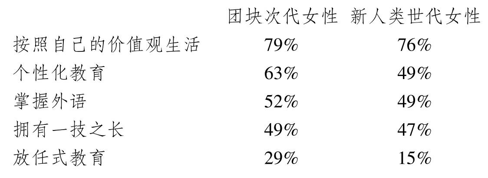
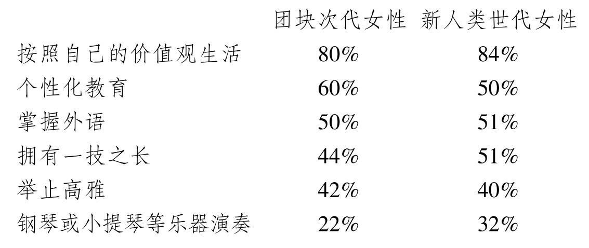

## 上流阶层拒绝放任式教育

先来看团块次代和新人类世代的女性，对于男孩子有着怎样的期待：

与新人类世代的女性相比，团块次代的女性当中选择“个性化教育”“放任式教育”的人较多，这或许是因为团块次代的女性经受过较大的升学压力的缘故。

根据不同的阶层意识来看团块次代，期望孩子“掌握外语”的人在上流阶层中占70.6%，希望孩子“拥有一技之长”的人在上流阶层中占58.8%。再来看新人类世代，在期望孩子“掌握外语”方面没有阶层差别，但阶层越是往“下”，希望孩子“拥有一技之长”的人数越多，这与团块次代在调查中显示出来的倾向有所不同。

此外，虽然选择的人数不多，但阶层差异较大的是“出国留学”一项，团块次代的上流阶层中有23.5%的人希望自己的孩子能够出国留学。另外，希望孩子接受“英才教育”“进一流大学或一流企业”“成为医生、律师、税务师”的也是阶层越往“上”人数越多。新人类世代在“留学”“英才教育”“成为医生、律师、税务师”方面没有阶层差异，只是较多上流阶层的人希望孩子“进一流大学或一流企业”。

还有一个特别明显的倾向，就是团块次代的上流阶层中，希望孩子有“高雅举止”的人占35.3%，中流阶层为26.9%，但下流阶层中有此期望的只占6.5%。不过这一选项在新人类世代中看不出什么阶层差异。

顺便说一下，在希望对自己的孩子进行“放任式教育”方面，上流阶层的人选择此项的占23.5%，中流阶层占30.8%，下流阶层占29.0%。虽然在统计学上很难说有什么明显的不同，但仅从以上数字来看，上流阶层中选择此项的人数略微少一些。同样，在新人类世代当中，上流阶层选择此项的人数为0，中流阶层和下流阶层中有此期望的人各占15.4%和20%。由此可见，这两个世代的上流阶层都不希望对自己的孩子施以“放任式教育”。

再来看看团块次代和新人类世代的女性，对于女孩子又有着怎样的期待：

团块次代的女性阶层越往“上”，期望女孩子有“高雅举止”的人越多，其中上流阶层女性所占比例为58.8%，中流阶层和下流阶层分别为46.2%和25.8%。新人类世代也是如此，期望女孩子有“高雅举止”的上流阶层女性占46.2%，中流阶层为40.4%，下流阶层则为37.1%，各阶层之间的差异不甚显著。

团块次代和新人类世代的女性对于女孩子“掌握外语”的期望，也显示出阶层越往“上”，有此期望的人数略有增多的趋势。

在“出国留学”“进一流大学或一流企业”“关心日本文化与历史”方面，新人类世代上流阶层女性中有此选项的人数较多，而在“英才教育”和“参加志愿者或国际贡献活动”方面，却是团块次代的上流阶层女性有此选项的人数稍多。

在是否对女孩子施以“放任式教育”这一点上，与对男孩子一样，团块次代和新人类世代的上流阶层女性中有此期望的人数都较少。

“个性化教育”的理念在团块次代中不存在阶层差异，但在新人类世代当中，则显现了阶层上的差异，因为新人类世代的上流阶层中有61.5%的女性希望对女孩子进行个性化教育，而在中流阶层和下流阶层中这一比例分别降至57.7%和34.4%。

团块次代的女性中较少有人期望女孩子会“钢琴或小提琴等乐器演奏”，也不存在阶层的差异；然而较多新人类世代的女性有着这方面的期望，并且还存在着阶层的差异，上流阶层中所占比例达到了将近半数的46.2%。

为什么团块次代的女性在“个性化教育”“乐器演奏”方面没有阶层差异，而新人类世代的女性在这两个方面却存在着阶层的差异呢？

究其原因，或许是因为新人类世代与团块次代一样，都认为有个性是件好事，而且阶层越往“上”，愈加追求个性。事实上，在被问及“生活中所重视的事情是什么”时，新人类世代中选择“有个性、按照自己的价值观生活”的比例已经显现出阶层的差异，其中上流阶层为61.5%，中流阶层为42.3%，下流阶层为37.1%。除此之外，还有一个原因是新人类世代从幼年就开始学习钢琴或小提琴等乐器，在当时被视为一种社会地位的象征。

但正如前述，对团块次代来说，有个性、按照自己的价值观生活的志向已经普及到了下流阶层，而且不论是谁都可以学习乐器，因此在这方面也就不存在阶层差异了。
