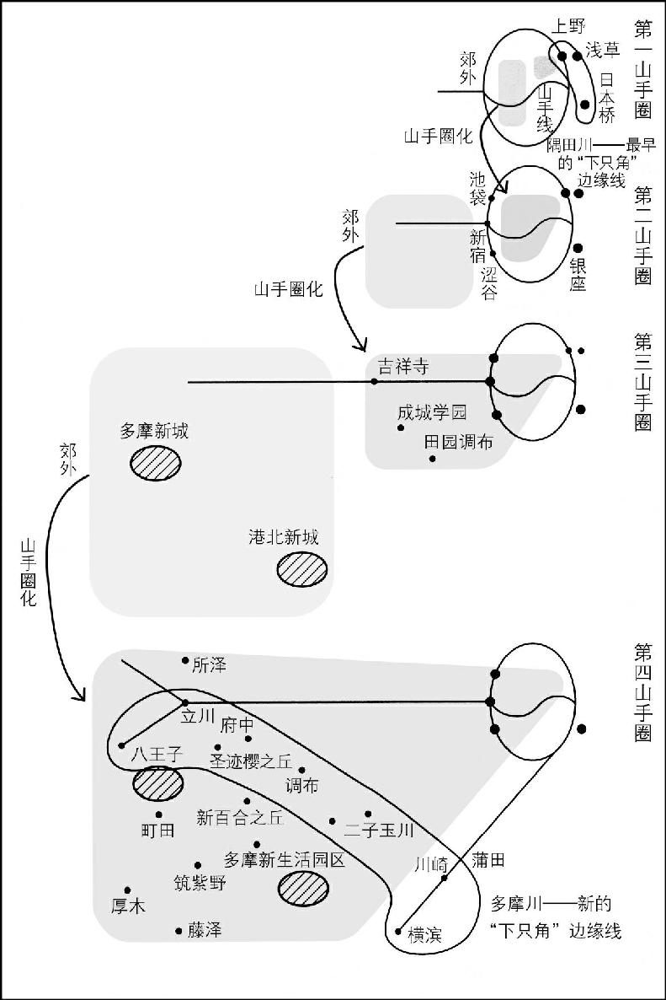

## 东京的地形——山手圈和“下只角”

在有关东京地理的书籍当中肯定会提到，东京的地形就如同将左手五指张开、指尖向右放置的形状，手指的部分是山丘（台地），手指和手指之间则是谷地。

首先，在神田的北面，是东京大学所在的本乡台地，从那里到丰岛区属丰岛段丘，它的对面是武藏野段丘；目黑川的周边则是目黑台，它的南面是久原台，位于多摩川对面的是多摩丘陵。

就这样，东京的地形由山丘和谷地组成，越往西面是地势越高的丘陵地带，东部则是延伸开来的低地。这种地形特征决定了东京的住宅发展历史，并与居住在那里的人们的社会阶层有着密切的关系。

在笔者以前编辑的杂志中，曾经提出过所谓的“第四山手圈论”（参见图8-1）。

图8-1　山手圈的移动

（资料出处：ACROSS编辑部“东京的扩张”）

上野车站的东侧是一片低地，从那里往美术馆、博物馆的方向走，会遇见一道陡坡，那就是被称为上野之山的西乡山。在它的西面是前面提到过的本乡，那里有加贺百万石的屋舍，笔者将这块台地命名为“第一山手圈”。

此后，在明治（1868—1912年）、大正（1912—1926年）时代，位于如今市中心的地铁环线山手线内侧西半部丘陵地带、原为武士所有的土地开始向民间出售，并且被开发为住宅用地，笔者将那一带命名为“第二山手圈”。当地的很多地名中都有一个“山”字，当今日本皇后美智子出生的地方就叫池田山。还有叫作代官山的地方，那里有一座西乡山公园。

从大正后期至昭和（1926—1989年）初期，更多西侧的土地被开发为住宅用地。因为当时东京的人口急剧增加，还有一个原因就是关东大地震，使得东面低地上的住宅几乎被破坏殆尽，人们无法继续在那里居住，于是很多人搬迁到了西侧的丘陵地带。这样便渐渐形成了“第三山手圈”，它的区域相当于世田谷区、杉并区和目黑区一带。建造于那个时代的田园调布、成城，如今成了东京乃至全日本具有代表性的高级住宅区，荻窪和吉祥寺等也都是从那个时候发展起来的人口聚居地。日本皇太子妃雅子的出生地就在目黑区的洗足。换句话说，日本皇后的诞生地从第二山手圈外移到了第三山手圈。

接着便是“二战”之后，急速的城市化使得东京都的区域不断向多摩川西侧的多摩丘陵延伸扩大，町田、八王子、多摩新城，还有位于横滨市和川崎市的青叶区、麻生区、港北新城等陆续被开发和建成。于是就像电视剧《金妻》当中所描绘的那样，东急田园都市线沿线等地随着居民的高龄化，住宅也日渐高级化了。从这种现象入手，可以发现从现在开始，新的山手圈将从这里诞生，这也就是笔者所提出的“第四山手圈论”。
