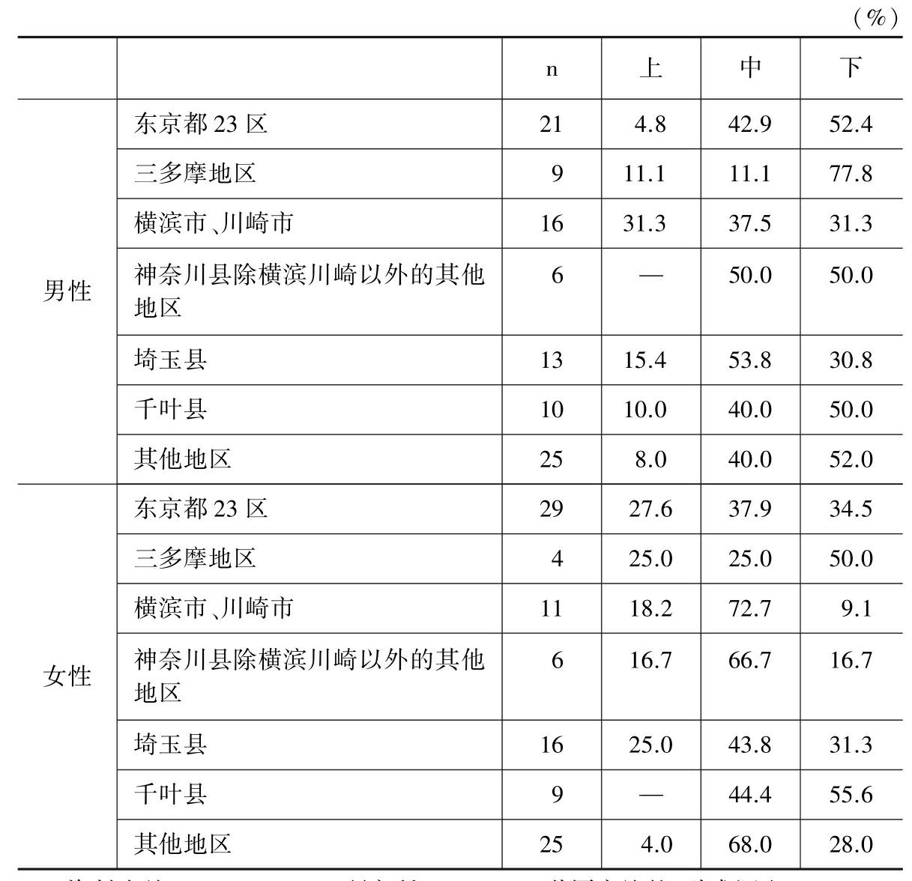

## 东京本地以外的人难以进入上流阶层

接着我们再根据“欲求调查”的结果，来看看出生于不同地方的人的阶层意识有何差别（见表8-3）。这部分调查选取的样本数量比较少，所以也权作参考。

表8-3　出生于不同地方的团块次代的阶层意识

资料出处：Culture Studies研究所、e-FALCON共同实施的“欲求调查”

出生于横滨市和川崎市的团块次代男性，属于上流阶层的较多。可以说在横滨或川崎出生并且现在仍然居住在那里的男性，具有较高的阶层意识。

此外，出生于东京都23区的人属于上流阶层的不多，而出生在三多摩地区的人绝大多数属于下流阶层，个中的原因却无从知晓。

另一方面，出生于首都圈一都三县的团块次代的女性大约有两成左右属于上流阶层，但出生于东京以外的属上流阶层者就非常少。对于女性来说，出生于东京一都三县似乎有助于她们的阶层意识高扬。

但是，出生于东京之外的地方的女性，属于下流阶层的却很少。这可以解释为能够特地把女儿从其他地方送到东京来，这样的家庭无疑具有一定的经济实力。或许她们在当地本属于上流阶层，来到东京后就成了中流阶层。

综上所述，可以肯定的是在东京郊外，特别是横滨市、川崎市出生并长大的这个背景，对于现在的团块次代的阶层意识有着正面影响。可以说以东急田园都市线沿线地区为中心的第四山手圈，正在逐渐演变为团块次代的上流社区。
