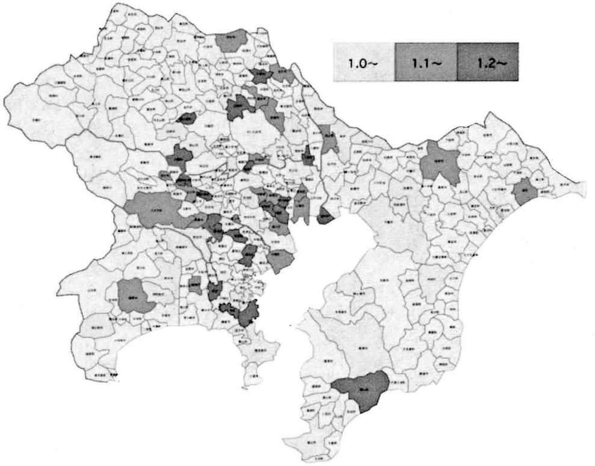

## 郊外社区化、“当地一族”与互联网

不过这种状况并不是自然形成的，而是因政府的相关国土政策诱导而产生的。1985年，日本国土厅颁布了“首都改造计划”。该计划的主要内容就是，由于东京市中心的功能过于集中，因此准备将一部分功能分散到郊外，拟定中的分散区域为东京都的立川、八王子，神奈川县的横滨、川崎，以及埼玉县的大宫、浦和，并准备将千叶县的千叶市发展成区域行政中心城市。此外，再将三县内的厚木、平塚、横须贺、青梅、所泽、川越、东松山、熊谷、成田、柏、船桥、东金和木更津扩充为副中心城市。

该计划目前可以说是正在圆满实现之中。也就是说，居住在所泽一带的人可以不必去东京，也照样能够在当地的西武百货公司、专门针对年轻人的时尚之都“PARCO”或者“吉之岛”等大型百货连锁店里购物，使得在所泽生活变得十分便利。即使是百货商店里买不到的东西，也可以通过上网来订购。

二十年前，大宫的百货商店只有一家老旧的“高岛屋”，如今有了“LUMINE”“崇光”等各式各样的大型百货商店。所以如果你去大宫进行实地调查的话，就会发现上尾的女高中生只在大宫购物，她们已经不再去东京池袋之类的繁华商业区，因为嫌那里的人太多；住在厚木的人只去町田，也不会去新宿这样的闹市区。在某种程度上，郊外已经逐渐形成一种独立而又完备的状态，这样，在郊外长大的年轻人当然就会喜欢自己居住的地方，完完全全变成“当地一族”。

此外，在都市中心就业的人数已经日渐减少，而另一方面，郊外区域中心城市的就业人数则在逐步增加。虽然还只是初露端倪，但在郊外居住、在都市中心工作的时代已经开始向在郊外居住、在郊外工作的时代转变了。

像这样在郊外出生和长大的年轻人，他们上学、购物、就职的地点也都在郊外，这也正是町田、大宫、柏等郊外商业中心近年来颇具人气的原因，毕竟不用特地到新宿、池袋或是上野，生活中的各种需求就都能够得到满足了。

正因为这个原因，现在零售业销售额增加的区域大多是在郊外。图8-3显示的是首都圈的零售吸引力上升率。所谓零售吸引力，是指以某个广域地区的人口为分母，再以该地区的零售业总销售额为分子，将两者相除后得到的数值作为参照，来分析该区域中某个特定地区的聚客能力的指标。如果某地区的零售吸引力高于100（例如110），就表示该地区从邻近的市镇争取到了客户；相反，如果零售吸引力为90的话，那就是意味着地区内的客户被别的地区夺走了。

图8-3　首都圈的零售吸引力上升率（1988—2002年）

资料出处：数据源自日本经济产业省的“商业统计”，由Culture Studies研究所绘制我们来对1988年与2002年的零售吸引力上升率进行一番比较。零售吸引力上升的地区，在都市中心的仅有东京都千代田区、港区和涩谷区，其余则都在郊外。在吉祥寺、世田谷、目黑以及调布等地，客户在一点一点被夺走，足立区、江户川区、练马区、板桥区的客户也在不断流失。概而言之，都市中心和郊外16号国道沿线以外的地区，再者是有高速公路出入口的地域，零售吸引力呈现出上升的态势。

换句话说，就算不去都市中心也没有关系。在立川既有“高岛屋”，也有“伊势丹”，原宿最有人气的流行名牌“UNITED ARROWS”在郊外立川的商业街也能找到，反而在市中心的吉祥寺却见不到它们的踪影。郊外正在逐渐脱离都市中心而独立发展成为富有特色的区域商业据点。

所以，春日部的人想继续居住在春日部，厚木的人想继续居住在厚木，柏那个地方的人也愿意继续住在当地。从某种意义上来说，只不过是一部分“胜组”的人士为了独自一人生活，或者过“丁克”生活，才搬到都市中心去住。

当然，如果今后东京市中心的港湾地区大量超高层住宅全部建成的话，情况将会变得如何还很难预料。但从前述“居住环境研究所”的调查结果来看，就算是比较喜欢高层住宅的团块次代，头脑当中也还是根深蒂固地想要拥有带庭院的独栋建筑，特别是有计划生育孩子的人更是如此。因此，即便简单地从郊外团块次代的人口没有减少，再加上他们所生的孩子这一点来说，团块次代的人口以及家庭数量依然会以郊外为中心不断增加。
