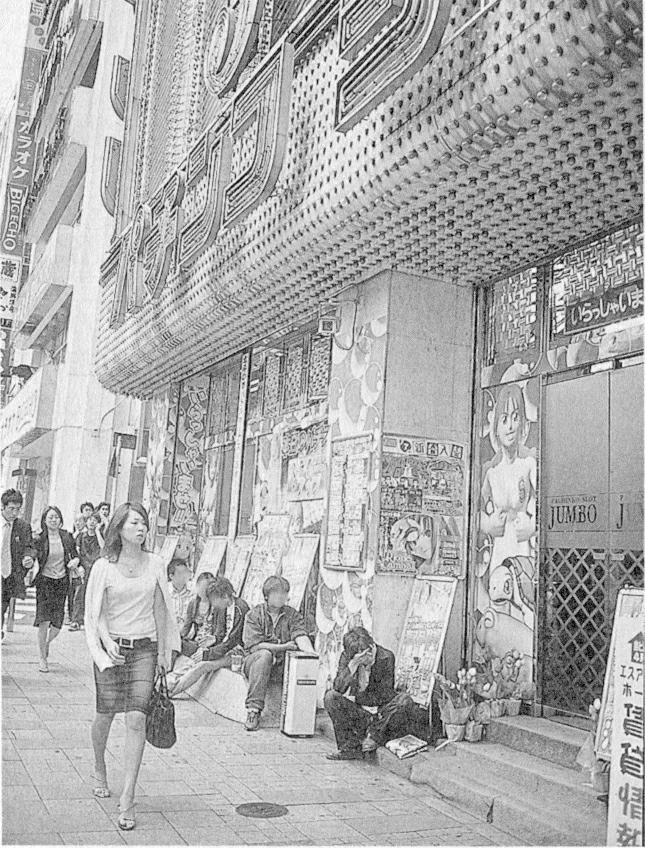

## 多样化的国家还是四分五裂的国家？

嘴里说着按照自己的价值观生活有多么重要，但不做任何努力、做事半途而废的人，再过5年、10年，到了三十多岁、四十多岁的时候，会变成什么样子呢？这是一个大问题。

当然，三十多岁自由打工族人数的增加可能只是过度期，但到了四十多岁仍旧做事半途而废的人终究是要被淘汰的，最后剩下的是那些真正坚持自己的价值观，并且能以独有特性为武器工作赚钱的人，这种可能性并非不存在。到了那个时候，日本或许会成为一个非常多样化而又丰盛的文化大国。

但是，在残酷的生存竞争中败下阵来的人们，以后是否能够在努力追寻自己的梦想而得到满足感的同时，找到固定的工作，过上即便“下流”也快乐安定的生活？还是像山田昌弘教授所忧虑的那样，一边经受着梦想破灭之后失败感的折磨，一边只能无力地维持生活，成为真正沉沦到社会底部的下流阶层？这或许是日本今后不得不认真面对的大问题。

笔者曾经亲身经历过这样一件事情。有一次笔者领着某家大企业的设计师和负责产品开发的人走在颇受年轻人青睐的下北泽的街道上，目的是为了亲身感受一下年轻人的气氛。

但走着走着，那两个人中的一个突然怒气冲天。

原来下北泽有个特点：商店街上的店门很晚才开，上午11点钟开门已经算是早的，很多商店要到12点钟甚至下午1点钟才开始营业。那里的店员大多是打零工的，来这里的年轻人也大多是打工族。所以白天的时候整条街上毫无生气，感觉就像是在昏睡中。

那个人为此非常恼火：我们每天都在辛苦工作，每天都要加班到很晚，可这些家伙究竟在干什么呢？！他说着说着竟中途返回了。

白领女性风风火火走过坐在“扒金窟”门口的男性面前

这不单纯是做事顶真的人与懒散闲荡的人之间的对立，或许也是身为正式雇员且工作认真的中流阶层与身为非正规就业者、习惯懒散生活的下流阶层之间的对立。或许将来总有一天，上流或中流阶层会变得不再去考虑下流阶层的事情，就如布什不会去考虑伊拉克平民百姓的生活一样，不，他也许连美国失业者的心情都懒得去理会。

少数精英分子为国家创造财富，而众多的社会大众则消费国家的财富，过着“唱唱跳跳”快乐无忧的生活。小泉纯一郎、竹中平藏的经济政策本来是着眼于扩大国内需求，也就是说，是以扩大阶层差距为前提的，但是失业率5%、在年轻人中更是高达10%以上的状态一旦成为社会常态，每年有将近4万人自杀，这还能称得上是快乐无忧的生活吗？

然而在日本国民当中，认为应当矫正阶层差距的人正在日渐减少（据日本内阁府“国民生活偏好度调查”），认为阶层差距的扩大在所难免的人却在不断增多。由此可见日本国民已经开始倾向于不努力就得不到回报的差别化社会模式，而不再选择努力和不努力结果都一样的“结果恶平等”的社会模式。
