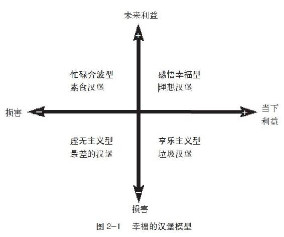

第2章 解读人生的四种汉堡模型

 自然界给了每一个人幸福的机会，人们都知道，却不知如何得到它。

——克劳狄

年度最重要的壁球赛就要临近了。我每天的训练已经极度艰苦，同时还要严格控制饮食。尽管我的饮食习惯已经相当健康，这是我训练规则的一部分，但我偶尔也会放纵自己“奢侈”地吃一点垃圾食品。

然而，在开赛前四个星期，我只吃最瘦的鱼肉和鸡肉、全麦的主食，以及新鲜蔬菜和水果。我告诉自己，为了好好犒劳一下自己的忍耐力，等比赛一结束，我一定要好好大吃两天垃圾食品。

比赛一结束，我就直奔最爱的汉堡店，一口气买了四个汉堡。离开柜台时，我深深地体会到巴甫洛夫的实验犬听到铃声时的感受。我坐下来，迫不及待地撕开第一个汉堡的纸包，就在将汉堡放在嘴边的一刹那，我突然停住了。

整整一个月来，我是多么期盼这一刻的到来。然而当汉堡就在我面前时，我居然不想吃了。我努力思考这是为什么，就在那时，我的脑海里形成了所谓的“幸福模型”，我更愿称它为“汉堡模型”。

我认识到，在上个月，健康饮食不但使我身体健康而且体能充沛。我相信我会很享受这四个汉堡的美味，但吃过之后我可能会后悔并影响健康。

看着眼前那四个汉堡，我思考了四种汉堡模型——每种汉堡都有自己的独特之处，正好代表了四种不同的人生态度和行为模式。

四种汉堡模型，四种人生模式

第一种汉堡是我最先拿起来的汉堡，它虽然口味诱人，却是标准的垃圾食品。吃它等于享受现在的快乐，却为未来埋下了痛苦。

为及时享乐而出卖未来的幸福人生，这样的人可以被称为“享乐主义型”。“享乐主义型”的格言就是“及时行乐，逃避痛苦”，他们注重的是眼前的快乐，却忽视了自己的行为可能带来的任何负面后果。

第二种汉堡虽然口味很差，可里面全是蔬菜和有机食物，食用这类汉堡可以确保日后的健康，但却让食用者吃得很痛苦。这类人与“享乐主义型”相反，他们只追求未来的快乐，承受着现在的痛苦。

我称这类人为“忙碌奔波型”。这种人认为此刻的一切努力都是为了实现未来的目标，痛苦的过程是获得未来幸福的必由之路。

第三种汉堡最糟糕，既不好吃也不健康，如果吃了它，不但现在无法享受美味，日后还会影响健康。与此类似，有一种人对生命已经丧失了希望和欲望，他们既不享受眼前的所有，对未来也没有任何期望。我称其为“虚无主义型”。

上述三种类型并不是我们全部的选择。会不会还有一种汉堡，与第一种一样好吃，并且与第二种一样健康呢？会不会有一种能平衡当下及未来益处的汉堡呢？

第四种汉堡就是“感悟幸福型”汉堡。生活幸福的人，不但能够享受当下所做的事情，而且通过目前的行为，他们也可以拥有更加满意的未来。

图 2–1 解释了四种类型在现在和未来的获益情况。纵轴代表未来，向上为正面影响，向下为负面影响。横轴代表现在，向右为正面影响，向左为负面影响。

我介绍的这些不同类型的汉堡，只是理论上的分类，并不代表任何具体的人。其实，我们每个人或多或少都会有每种类型的一些特点。为了能更清晰具体地解释每一种类型，我给大家讲一个有点像寓言的故事，不过我所强调的只是主人公所代表的类型而不是他本身。现在就让我们跟着蒂姆，一起来看看他不同的人生阶段。

反思： 回顾你过去和现在的生活，你经常处于哪一个或者哪两个象限呢？

忙碌奔波型

蒂姆小时候是个无忧无虑的孩子，从来不为未来担忧，他每天的生活都充满着惊奇与兴奋。不过，从六岁上小学那天起，他忙碌奔波的一生就开始了。

他的父母和老师经常提醒他，上学的目的就是取得好成绩，这样长大后才能有个好未来。然而，没有人告诉他学校也是个可以获得快乐的地方，或者说，学习本身就应该是一件开心的事情。

由于害怕考试考不好，担心作文中有错字，蒂姆极其焦虑并且背负着很大的压力。他每天盼望的只是下课和放学，他的精神寄托就是每年的假期，因为只有那时他才不需要为功课和分数而烦恼。

蒂姆逐渐开始接受大人的价值观——成绩就是成功的唯一标准。虽然他不喜欢学校，但他还是努力学习。当他成绩优秀时，父母和老师都会夸奖他，被灌输了同样观念的同学们也非常羡慕他。升入高中后，蒂姆对成功的公式更加深信不疑：牺牲现在的快乐，才能换取未来的幸福；没有痛苦，就没有收获。虽然他对学业和校园活动并无好感，但他还是全力以赴，荣耀的光环推动着他。当压力大到无法忍受时，他会安慰自己说：“考上大学后，一切都会变好的。”

收到大学录取通知书时，蒂姆激动地落泪了，他感到喜悦和释然。那一刻，他郑重地告诉自己，终于可以享受幸福了。

然而，好景不长。没过几天，熟悉的焦虑又卷土重来。他担心不能在与同学的竞争中取胜。周围的同学都是最优秀的学生，如果无法击败他们，将来如何找到理想的工作呢?

他继续忙碌奔波着。四年大学期间，他努力地为未来打造了一份漂亮的简历：他成立了一个新的学生社团，在另一个社团中担任主席，做志愿者帮助无家可归的人，参加各种运动项目……他小心翼翼地选修课程，而这完全不是出于兴趣，仅是为了让自己有一张光鲜的成绩单而已。

当然，蒂姆或多或少也有些开心的时候，特别是在完成了一些艰难的任务之后。但这些快乐完全来自于如释重负的感觉，它们并不持久，焦虑很快又会如影随形般降临。

在大四那年的春天，蒂姆被一家著名的公司录用。他再一次兴奋地告诉自己，终于可以开始享受生活了。但他很快发现，这份每周需要工作80小时的高薪工作让他倍感压力。他说服自己，小小的牺牲没关系，只有努力地工作，职位才会更稳固，才会更快地晋升。像读大学时一样，他偶尔也会开心一下，因为加薪、奖金或升职等原因，但这些满足感同样很快便消退了。

在多年的超负荷、超时长的努力工作之后，公司邀请他成为合伙人。他依稀记得当初曾认为如果有一天可以成为合伙人的话，一定会非常幸福。但是，当这一天真的来临时，他并没有感到丝毫的快乐。

蒂姆在大学里是一个优秀的学生，现在是一家知名公司的合伙人，和家人住在一栋豪宅里，开着跑车，银行的存款一辈子都用不完，但是他并没有感受到丝毫幸福。

具有讽刺意味的是，蒂姆被身边所有人认定为成功的典型，朋友们把他视为偶像，教育小孩时也会以蒂姆为榜样。但是，蒂姆为可能和他拥有一样命运的孩子们感到悲哀，可除此之外还有什么更好的选择？他甚至不知道如何教育自己的孩子——难道告诉他们，在学校不用努力，不用上好大学，不需要找好的工作？到底是不是想要成功就必须忍受痛苦呢？

虽然蒂姆是一个不快乐的忙碌奔波者，但是有一点值得注意，那就是还有很多每星期工作80小时的人，他们对工作抱有极大的热情，并且完全自觉地投入到工作之中。从来没有谁规定，成功一定要以牺牲快乐为代价。有很多人为了学业、工作每天努力奋斗，他们也过得十分开心。“忙碌奔波型”和这些人最大的不同，就是他们不懂得去享受他们正在做的事情，还坚守着根深蒂固的错误观念：“一旦目标实现，就会开心快乐。”

为何有这么多“忙碌奔波型”的人呢？最主要的原因是我们的文化造就了这种信念：如果成绩全优，家长就会给我们奖励；如果工作表现好，就会得到奖金。我们习惯了去关注更远大的目标，却不在意当下的感受，最后导致终生的盲目追求。我们从不会因为享受过程而得到奖励，我们认为能否达到目标才是衡量一切的标准。社会只褒奖成功的人，而不是正在努力的人——只看结果，而无视过程。

一旦达到目标之后，我们经常会把放松的心情解释成幸福，好像工作越艰难，成功后幸福感就越强。因此，当我们拥有这种错觉时，就不由自主地对这种生活方式屈服了。不可否认，这种解脱让我们感到真实的快乐，但是它绝不等同于幸福。

这种幸福可被称为“幸福的假象”，它们来自于压力和焦虑的消除，无法长久维持，因为它本身就是与负面情绪共生的。这就好比一个人头痛好了之后，他会为头不痛了而高兴。然而，由于这种喜悦来自于痛苦的前因，当痛楚消散，我们很快就会把健康当成一种理所当然的事，病愈的喜悦早已消失得无影无踪。“忙碌奔波型”的人错误地认为成功即是幸福，坚信目标实现后的放松和解脱即是幸福，因此他们不停地从一个目标奔向另一个目标。

反思： 回想一下，你是否在某一段时期，曾经忙碌奔波地生活。如果有，以一个旁观者的角度给自己一些建议。

享乐主义型

“享乐主义型”的人总是在寻找快乐并且逃避痛苦。他们只是盲目地满足欲望，却从不认真地考虑后果。他们认为，充实的生活就是不断地满足自己各种各样的欲望。眼前的事只要能让自己开心，就值得去做，等找到下一个更刺激的乐子再说。他们在爱情和友情方面精力旺盛，但新鲜劲儿一过，他们就开始物色下一段感情。由于享乐主义者只看重眼前，短暂的快乐有时会让他们失去理智。如果吸毒能带来快感，他就会去吸毒；如果工作辛苦，他就会逃避。

享乐主义者根本的错误在于将努力与痛苦、快感与幸福等同化。有这样一个故事。一个冷血的歹徒被警察打死后，天使出现了，对他说可以答应他任何要求。一开始歹徒对自己可以进入天堂感到难以置信，随后他慢慢接受了这个事实，并开始贪婪地要求——大笔的金钱、山珍海味、美女，每次都能如愿以偿，他感觉好极了。

但是慢慢地，他的喜悦越来越少，这种不劳而获的生活让他感到无聊。于是，他向天使请求做一些有挑战性的工作，但天使回答道：“这里什么都有，就是没有事情可做。”

在没有任何挑战的情况下，他越来越不开心。终于，他向天使提出了离开天堂的请求。他说就算是去地狱，他也要离开。忽然之间，天使变成了魔鬼的样子，魔鬼笑着对他说道：“你早就在地狱了。”

这就是享乐主义者误认为天堂的地狱：没有目的和挑战，生活变得毫无意义。如果我们只想着享乐，总是逃避挑战和问题，那和一般动物有什么不同呢？但每个人心中多少都会有一些“享乐主义型”的成分，把努力和痛苦等同化，只图享乐而不再追求生命的意义，期待理想中的伊甸园早日出现。

在一个与上述故事类似的研究中，心理学家付费给一些大学生，对他们的要求就是什么也不能做。他们的基本需要得以满足，但是被禁止做任何工作。4~8小时后，这些大学生开始感到沮丧，尽管参与研究的收入非常可观，但他们宁可放弃参与试验而选择那些压力大、收入也没有这么多的工作。

1996年，我曾为一批南非的政府官员讲授如何培养领导力。他们告诉我，在对抗种族隔离的运动中，他们有着极为清晰的使命感，虽然当时的生活很艰难，甚至很危险，却因充满挑战而令人兴奋。

当种族隔离制度被废除时，南非人民庆祝了好几个月。然而，当狂喜慢慢消退，许多曾为破除种族隔离制度而奋不顾身的人，开始感到厌倦、空虚，甚至沮丧。当然，没有人愿意再回到从前，但在全心全力投入的伟大事业告一段落之后，他们确实感觉无所适从。其中一些人尝试着去找寻新的生活意义，包括家庭生活、社会责任、工作或是个人爱好；但也有一些人，即使在多年以后还是无法找到生活的新方向。

米哈里·契克森米哈伊毕生致力于研究高峰体验和巅峰表现，他曾说过，“人类最好的时刻，通常是在追求某一目标的过程中，把自身实力发挥得淋漓尽致之时”。享乐主义者的生活完全没有挑战，因此不可能获得幸福。美国前卫生教育与福利部秘书长约翰·加德纳（John Gardner）说过，“无论在山谷还是山巅，我们生来就是为了奋力攀登，而不是放纵享乐”。

现在让我们回到蒂姆的故事中来。由于无法在盲目的追求中找到幸福，于是他决定干脆把注意力放在当下。他开始酗酒、吸毒，麻醉自己，尝试只以快乐为目的滥交。他尽可能地延长假期，在阳光下一待就是几个小时，享受着毫无目的的人生，再也不去担心明天的事。起初他发现这样快乐极了，但就像前面故事中的那个歹徒一样，蒂姆很快就感到了厌倦与不快。

反思： 回想一下，你是否有过作为享乐主义者的经历或者一段享乐的生活，这种生活的好处和代价分别是什么？

虚无主义型

“虚无主义型”的人是指那些已经放弃追求幸福的人，他们不再相信生活是有意义的。如果“忙碌奔波型”代表为了未来而活，“享乐主义型”代表为了现在而活，“虚无主义型”则代表沉迷于过去而放弃现在和未来的人，他们被过去的阴影所笼罩。

心理学家马丁·塞利格曼将这种心态称为“习得性无助”。在他的研究中，塞利格曼将实验狗分为三组。在三个地板充电的房间里，第一组实验狗被轻微地电击，在它们旁边有一个开关，只要碰一下，就可以停止电击。第二组实验狗也遭受了电击，但它们没有任何方法阻止电击。第三组实验狗则完全没有受到电击。

过了一会儿，所有的狗都被关进一个大箱子，箱子边上有着很矮的栏杆，接着实验人员开始对它们进行轻微电击。第一组（曾经被电击但学会了操纵开关停止电击的狗）和第三组（没有被电击过的狗）很快就跳出了栏杆；第二组（之前无法停止所遭受的电击的狗）只是在原地哀号，这些狗就是“习得性无助”的受害者。

在一个类似的实验里，塞利格曼让两组受试者听噪音。第一组受试者有阻止噪音的方法，而第二组受试者则无法阻止噪音。之后，他再次向两组人播放噪音，这一次大家都有阻止噪音的方法，但先前实验中的第二组受试者却无动于衷，原因就是“习得性无助”。

塞利格曼的实验证明，人非常容易陷入“习得性无助”的状态中。所以当失败或无助时，我们经常会选择放弃，甚至感到绝望。

蒂姆做“忙碌奔波型”的人不快乐，做“享乐主义型”的人也不开心，因为找不到出路，他决定向命运投降，听天由命。但他的孩子们呢？蒂姆并不希望自己的孩子也陷入“安静的绝望”，可他又不知道该如何教育子女。教育他们为了成功放弃眼前的幸福吗？不行，忙碌奔波太痛苦了；教育他们为了快乐去过及时行乐的日子吗？也不行，享乐主义只会带来空虚。蒂姆陷入了前所未有的痛苦中。

反思： 回想一下，在某件事情上或是某段时间里，你是否也曾感到堕入了虚无主义的旋涡，除了眼前的不幸，看不到任何希望。如果当时可以从旁观者的角度给自己一些建议的话，会是什么样的建议呢？

“忙碌奔波型”、“享乐主义型”和“虚无主义型”的人都犯了同一种错误，那就是坚持自己对于幸福的偏见。“忙碌奔波型”信奉的是“实现谬论”，即认为只有在实现一个有价值的目标后，才可以得到幸福。“享乐主义型”的问题在于“快乐至上”，认为只要不断地享受短暂的快乐，就算没有实现目标，也可以得到幸福。至于“虚无主义型”本身就是一种谬论，是对现实状况的完全误读，认为自己无论做什么都无法得到幸福。这种类型的人最可怜，因为他们连前两种谬论中有限的快乐都感受不到。

感悟幸福型

我的一个学生收到了一家著名咨询公司的录用聘请，她来找我说自己并不喜欢那份工作，但是又难以拒绝。虽然别的公司提供了她喜欢的工作，但是没有一家的薪水能与这家公司相比。她说，这两类工作都不能令她心满意足。她问我，要到什么年龄才能够停止为未来担忧，全然地去享受生活。

我告诉她，不要问自己“是否应该享受当下的快乐或者未来的幸福”，而要问“如何才能享受当下的快乐以及未来的幸福”。

当然，眼前和未来的收益有时是冲突的，在有些情况下我们确实容易顾此失彼。但大多数情况下，眼前和未来的幸福是可以平衡的。比如，一个热爱学习的学生，可以在学习的过程中享受创造的快乐，而这种快乐也可以帮助他取得好成绩，并且在未来获益。谈恋爱也一样，两人共同享受着爱情的美好，帮助彼此的成长与发展。同样，当我们从事自己喜爱的事业时，无论是商业、医学还是艺术，我们一样可以在享受的过程中取得事业的进步。

但有一点要切记：如果企图永远幸福，可能只会导致失败与失望。并不是每一件事都可以同时为我们带来当下与未来的幸福。有些时候，我们确实需要牺牲一点快乐，去换取目标的实现，有些平淡或琐碎的付出是无法避免的。就像为考试而学习、为未来而攒钱、为实现一个目标而超时工作，这些都会带来些许不快，但确实可以帮助我们在未来获益。重点是，就算我们必须牺牲一些眼前的快乐，也不要忘记我们仍然可以从生活的方方面面尽可能地发掘出能为当下和未来带来幸福的行动。

其实，享乐主义也有一定的好处，只要它不带来任何负面的结果，有时把注意力放在眼前的幸福上，也可以让自己放松，产生焕然一新的感觉。只要是适度的，有时放松一下自己，什么也不想，投入自己的爱好中，可以让我们更幸福。

反思： 回想一下，在某一件或两件事情中，你是否曾同时体会到当下和未来的幸福。

“忙碌奔波型”的错误观念在于，只有成功本身可以为他们带来快乐，他们感觉不到过程的重要性。“享乐主义型”则错误地认为，只有过程是重要的。“虚无主义型”同时放弃了过程和结果，他们对生活已经麻木无感了。“忙碌奔波型”是未来的奴隶，“享乐主义型”是现在的奴隶，而“虚无主义型”则是过去的奴隶。

真正能够持续的幸福感，需要我们为了一个有意义的目标快乐地努力与奋斗。幸福不是拼命爬到山顶，也不是在山下漫无目的地游逛，幸福是向山顶努力攀登过程中的种种经历和感受。

练习

四个象限的特别日志

有研究表明，敞开心扉，把正面和负面的经历都写下来，可以提高我们的身心健康水平。

连续4天，每天用15分钟的时间，写下你在四个象限里的经历。无论是一件事，或是人生中某一段时期的感受，写下你处于“忙碌奔波型”、“享乐主义型”以及“虚无主义型”时期的经历。在第四天只写下你处于“感悟幸福型”时期的经历。如果你对其中某个象限特别感兴趣，就多写一点，但每天的内容不要超过一个象限的范围。同时，也不要担心文字是否通顺优美，只管去写。要记得，写下你当时的感受和现在的感受、你当时的行为以及当时和现在的想法。

这里对每个象限的内容都有一些指导：

忙碌奔波型：写下你人生中忙碌奔波的经历。为什么曾经是那样？你是否从中受益？你付出的代价又是什么？

享乐主义型：解释一下你只顾享乐的时刻或经历。你是否从中得到了很多？你损失的又是什么？

虚无主义型：写下那个特别令你痛苦的时刻，或者那个令你感到绝望、无助的时刻，并描述你当时以及现在对它最深刻的感受和想法。

感悟幸福型：描述一下你人生中某个特别幸福的时期或者经历。发挥你的想象力，让自己再次回到那个时候，重温一下当时的感受，并写下来。

无论你写什么，都是写给自己看的。如果写完后你愿意和他人分享当然也可以，但在写的时候请不要抑制任何的念头和想法，越是勇敢地表达自己，你就越能从中受益。

在“虚无主义型”和“感悟幸福型”两个象限内，至少再多做两次练习。重复该练习时，你可以写同样或不同的内容。然后定期地回顾自己所写的内容，可以是三个月、一年，甚至是两年。

冥想幸福

正如赫伯特·本森、乔恩·卡巴–金和理查德·戴维森的研究报告所指出的，有规律的冥想可以为生活带来深刻的改变，但冥想并非适用于所有人。如果这个练习或是书中任何练习让你感到不舒适，就略过，然后直接进行下一个练习。

首先选择一个安静的地方，找把椅子，或是盘腿坐在地上。确定自己处于舒适的姿势，但背部和颈部要挺直。至于要不要闭上眼睛，由你自己决定。

深呼吸，试着保持心态平静，每次吸气都要吸到底，在呼出时，要通过口或鼻慢慢地呼出。

用意念扫描你的全身。如果有任何部位感到紧张，就将你的呼吸传向那里，并让这个部位放松。至少保持5分钟（最长20分钟），专注于你深缓的呼吸。如果发现注意力游移，只要把它简单而自然地带回到你的呼吸上即可。

继续深呼吸，让积极情绪包围自己。你可以想象自己在一个非常开心的状态中，比如和爱人共处或是在工作上得心应手的时候。用30秒到5分钟的时间，让这种积极情绪蔓延全身并在体内流动。如果经常做这个练习，你甚至不需要再去想象什么情景，只是想着“幸福”、“宁静”或是“欢愉”这样的字眼，就能引发积极的力量。

把冥想变成规律。每天早上起来、午餐时间或是午后，用10分钟到1小时的时间来冥想。在冥想成为日常规律后，你可能只需要一两分钟的时间就够了。每当你感到有压力、愤怒或是想开心一点的时候，只需要做几次深呼吸，就可以释放出积极的情绪。安静的地方是最理想的，不过坐火车、坐出租车或是在办公室里，其实也都可以。
