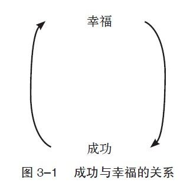
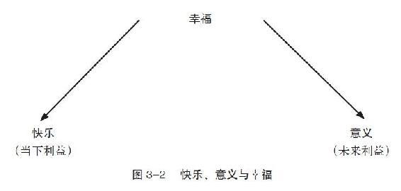

第3章 幸福的意义

 幸福是生命本身的意图和意义，是人类存在的目标和终点。

——亚里士多德

我们都熟悉孩子们那种永无止境的好奇心：为什么会下雨？水是怎么到天上去的？水为什么会变成气体？为什么云不会掉下来？其实，有没有得到答案对他们来说并不是最重要的，当他们对身边的事物产生好奇心时，他们会一直追问下去。得到答案不是他们的最终目的，他们看重的是那句“为什么”。

有一个问题可以让所有人停止追问“为什么”，这个问题就是：为什么要追求幸福？当被问到我们想要什么时，除了幸福之外，我们可以问出更多的“为什么”。比如，为什么要这么辛苦工作？为什么要赢得世界冠军？为什么要致富与成名？为什么要买好车、大房子和游艇？

当问题转为“为什么要追求幸福”时，答案其实是简单而肯定的。我们追求幸福，因为幸福是生命的一种基本需要。当答案是“因为这样可以使我幸福”时，便没有任何说法能够挑战它的正确性与终极性。幸福在所有目标中是至高无上的，其他所有目标的终点都只是通往幸福的起点。

英国哲学家大卫·休谟曾说过，“人类刻苦勤勉的终点就是获得幸福，因此才有了艺术创作、科学发明、法律规定，以及社会的变革”。财富、声望、地位与其他目标都不能和幸福相比，无论是物质上还是名望上的追求，其最终都是追求幸福的手段。

反思： 以不停地追问“为什么”来反思自己所追求的东西，可以是大房子、升职或是任何其他的目标，看看要问多少个“为什么”才能把你引到对幸福的追求上。

对于那些不认为幸福是最终目标的人，我想告诉他们的是，科学研究已经证明了一点，那就是幸福确实可以帮助人们在生活的方方面面取得更大的成功。在一个对“幸福感”研究的综述中，积极心理学家桑妮娅·吕波密斯基、劳拉·金，以及埃德·迪纳提出，“幸福的人在生活的各种层面都非常成功，包括婚姻、友谊、收入、工作表现以及健康状况”。报告也指出了幸福和成功之间存在强烈的相互作用：成功（无论是工作还是感情方面）可以带来幸福，而幸福本身也可以带来更多的成功（见图3–1）。

在其他条件一样时，幸福的人拥有更好的人际关系，在工作上的表现更好，活得也更开心、更长寿。幸福是值得去追求的，无论是作为目标还是达到目标的方法。

幸福是什么

当我们以为孩子对答案已经满意时，他们总会从问不完的“为什么”转到问不完的“是什么”和无穷无尽的“怎么样”。因此，为了避免有类似疑惑我会详尽解释“幸福是什么”和“如何才能幸福”这类问题。

我认为，幸福的定义应该是“快乐与意义的结合”。真正快乐的人，能够在自己觉得有意义的生活方式里享受它的点点滴滴。这种解释绝不仅限于生命里的某些时刻，而是人生的全过程。即使有时经历痛苦，人在总体上仍然可以是幸福的。

我们可以把这个解释与“感悟幸福型”相连：快乐代表现在的美好时光，属于当下的利益；意义则来自于目标，一种未来的利益（见图3–2）。

快乐

实际上，情感在我们所有的追求中扮演着一个关键的角色，包括我们对幸福的追求。很难想象一个缺乏情感的生命是什么样子。假设有一个机器人，除了没有情感之外，和人类一模一样，想法与行为亦无二致。它可以研究深奥的哲学，也可以推演复杂的逻辑，甚至还懂得建筑工程的知识。

虽然这个机器人精细无比，却没有表达能力。最基本的表达同样需要情感，这恰恰是它所缺乏的。机器人感觉不到食物的美味，也感受不到挨饿的痛苦或是任何饱腹的满足感。它不会去找吃的，但它的构造却和人类一样，所以它很快就会饿死。

现在，让我们来改编一下机器人的程序，让它学会吃喝。虽然它现在可以生存了，但仍没有表达的欲望，声望、财富和爱情等对它而言仍然毫无意义。

情感引发行动，它赋予我们行为上的动机。我们的语言就是一种证明——情感、行为与动机都密切地关联在一起。在拉丁文里，movere（motion/动作）代表动，前面加e的话则代表离去。动机（motivation）这个词来自于目的（motive），它来自于拉丁语的motivum，其意思为动作的理由。情感把我们带离没有欲望的世界，给了我们一种动机，促使我们行动。

神经病学家安东尼奥·戴姆西奥所记录的一个切除脑瘤的病人的情况，提供了一个情绪与动机之间关系的真实案例。手术后，这位名叫埃利奥特的病人的认知能力，即记忆、数学能力、感知力以及语言能力都没问题。但是在手术中，埃利奥特负责情感思考能力的脑组织受到了损伤，导致术后埃利奥特的情况和之前所说的机器人相似，他有着和其他人一样的生理机能，认知功能也没有差异，但其“感受和情感”系统却受到了损害。

埃利奥特的生活从此发生了巨大的变化。在手术前，他是个成功的律师，拥有幸福的婚姻生活；手术后，埃利奥特的“理智”虽然没有任何变化，但是他的行为却让周围的所有人都无法接受——致使他的妻子离开了他，他也失去了工作，而且很长时间内无法找到新的工作。最让人震惊的是，他对这一切都表现得无动于衷，包括人际关系和工作。

如果我们丧失情感，并因此失去行为的动机，我们将不再对生活存有任何渴望，也将对自己的行为与想法及其后果漠不关心。这说明，情感是动机的来源，它在我们追求幸福的过程中扮演了一个非常重要的角色。

但是，光有情感是不够的。如果要幸福，我们就必须体验积极的情绪或情感，因为快乐是幸福生活的先决条件。正如心理学家纳撒尼尔·布兰登所说，“快乐不是奢侈品，而是一种深层次的心理需要”。在完全没有快乐且频繁感受痛苦的生活中，几乎没有幸福可言。

当我提到快乐的时候，我并不是指情绪持续高涨的状态。我们都会经历情绪上的起伏，虽然生命中不可避免地会有悲伤的情绪，诸如失败或失去的时候，但我们依然可以活得幸福。事实上，期盼无时无刻的快乐只会带来失望和不满，并最终导致负面情绪的产生。幸福并不需要一直高涨的情绪，也并不是完全没有负面情绪。

一个幸福的人也会有情绪上的起伏，但他会在整体上保持一种积极的人生态度。他经常被积极的情绪推动着，比如欢乐和爱，而很少被愤怒或内疚这些负面情绪所控制。快乐是常态，而痛苦只是小插曲。要想获得真正的幸福，就必须明白无论遇到怎样的悲伤、考验或是波折，我们都应该为活着本身而感到由衷的快乐并感恩。

反思：想象一下那些带给你快乐的事情，从小事情开始。

是否情感愉悦的生活就可以让人满足？仅仅体验积极的情绪就是达到幸福的充分条件吗？那么那些通过毒品获得快感的人呢？还有那些整天躺在沙滩上晒太阳的人呢？他们真的幸福吗？答案是否定的，积极的情绪体验是幸福的必要但非充分条件。

意义

哲学家罗伯特·诺齐克在《无政府主义、国家与乌托邦》（Anarchy，State，and Utopia）中描述了一个假想的实验，帮助我们区分和分辨幸福以及纵欲带来的快乐。让我们想象有这样一部机器，可以让我们产生“写作一首伟大的诗篇，实现世界和平或者爱人并被人爱”的感受，或者任何我们期望的快感。这部机器可以让我们感受到真实的爱，而且我们完全不会察觉到这是机器的作用。这里要问的是：如果可以的话，我们会不会一生都选择使用这部机器？另外一种问法是：如果一辈子都使用这部机器，我们会不会拥有真正的幸福？

绝大部分人都不会选择机器。原因很简单，因为我们所关心的并不只是我们内在的感受。很少有人认为只有自己的感受才重要，除了想体验快乐外，人们还希望周围环境与自己的感受是一致的，所以幸福绝不仅仅是愉悦的情绪体验。

不管是通过机器还是通过毒品来逃避情感，都是生活在谎言中。在机器提供的缔造世界和平的虚假成就感与简简单单但却能真实地帮助他人这两者中，我相信大部分人都会选择后者。就好像有一个内在的机制告诉我们：幸福不只是快感，我们更需要这种愉悦感的来源是有意义的。我们要证实自己的行为确实能够改变世界，而不只是主观感受而已。

就情感上来说，人类和动物并无太大区别，像黑猩猩这种智商比较高的动物，它们的情感与人类其实是很接近的。如果没有情感的话（对动物来说可能用“感觉”一词更合适），我们将丧失所有的动力，生命将无法维持下去。在没有情感或感觉的情况下，我们就会像机器人一样麻木。

我们在情绪的感知能力方面与动物类似，但又有本质的不同。比如人类可以反思情感产生的原因，这是人类与其他动物的巨大差异。我们有能力反思我们的感觉、想法以及行为，我们也有能力清楚地感知我们的意识和经历。

人类和动物的另一区别是，人类是有灵性的。在《牛津英语大词典》里，灵性被称为“真切地感受到事情的意义”。动物无法过有灵性的生活，其行为的意义只限于追求满足感和逃避痛苦。

当想到有意义的生活时，我们经常谈到目标，却忽略了目标感其实比设定目标更重要。当然，有目标或者实现目标并不能保证我们必然感受到生存的意义。我们真正需要的是那些让我们从内心感到有意义的目标。

我们可以设置不同的目标，比如取得好成绩、买大房子，但当这一切实现后，我们仍然可能感到空虚。要过真正有意义的生活，目标必须是自发的，它是为了实现自我存在的意义，而不是为了满足社会标准，或是迎合他人的期望而设定的。当我们有这种目标感时，那种感觉就像是听到了“真我的呼唤”，它也被称为使命感。就像萧伯纳所说，“这才是生命的喜悦，那种为了源自真我的目标而奋斗的感觉”。

不同的人会从不同的事情里找到意义。“真我的呼唤”随时都有可能出现，创业、做义工、抚养子女、行医，甚至制作家具。重要的是，我们选择目标时必须确保它符合我们自身的价值观以及爱好，而不是为了迎合外界的期望。一个在工作中找到意义与快乐的投资家，一个出于正确动机的人，绝对比一个心不在焉之人的人生要高尚和有意义得多。

理想主义和现实主义

记得有一次我问一个朋友，他内心的呼唤是什么。他说，在他的生命词典里并没有什么使命或者更高的目标，“我不是理想主义者，我只相信现实”。

现实主义又可被称为实用主义，这种类型的人被认为是脚踏实地的人。理想主义者则常常被认为是梦想家，他们把目光放在远处的地平线，来思考自己的使命和生命的目的。

比较这两种类型时，如果我们认为理想主义者不切实际或是脱轨时，那么我们已经产生了一种错误的分裂感。其实，理想主义的实质根本就是现实主义，因为理想主义的想法完全符合人性的自然。人们对意义的追求是绝对的。如果没有更高的目的、使命感或理想，我们就无法发挥全部的潜能去追求幸福。当然，我不是鼓励大家只心动而不行动（两者都重要）。事实上，多数的现实主义者，特别是那些“忙碌奔波型”的人，都忽视了一个极为重要的事实：理想主义者本身就是现实的。

理想主义的真谛在于用一个更高的目标去指引生命。当然除了一个比较宽泛的意义外，我们还需要找出这些意义的具体内涵。比方说，如果为了达成建立一个幸福的家庭或者解放受压迫的人们这样的目标，我们就需要多花点时间与家人共进午餐，或者参加游行示威。只靠远大的理想是无法长时间支撑我们的行动的，我们需要为下周、明天甚至今天找出富有意义的事情。

反思： 想想那些对你来说有意义的事，有哪些事可以并且已经为你带来了使命感？你觉得生活中哪些行为和活动是有意义的？

如法国哲学家蒙田所说，“一个有使命感的生命是人类最伟大的作品”。一个明确的目标可以指引我们的方向，并赋予我们的生命意义——生命不再是支离破碎的片段，而是变成了一个有机的整体。同样，一个不可或缺的目标，就像协调每个音符的交响乐主题，让我们的行动更加协调一致。单个音符也许没有特别的意义，当它一旦成为交响乐的一部分，就会奏出无比动人的曲调。

潜力与幸福

当想到对自己最有意义的生活时，我们需要同时考虑如何充分地发挥自身的潜力。奶牛可以在牧场里开心过一辈子，人们却不能仅仅满足自己生理上的需要。我们内在的力量要求我们做得更多，充分发挥我们的潜力。哲学家伯特兰·罗素说过，“真正令人满意的幸福总是伴随着充分发挥自身的才能来改变世界”。

这并不意味着最有影响力的人必须成为总统或首相才能幸福，或是具备商业天赋的人必须得成为亿万富翁才能快乐。成为总统或亿万富翁只是潜力的一种表面证明，我所说的是潜力的内在标准。一个有潜力做总统的人大可以开开心心地做一个古代梵语研究者，那个有亿万富翁潜力的人也可以高兴地去当个记者。只要他们从内心感受到工作的挑战性，感受到自己的潜力得到了充分发挥就好。

反思：哪些事可以挑战并充分发挥你的潜力？

成功与幸福

有些人常怀疑，舍弃地位和财富而注重追求快乐和意义，会不会导致以牺牲成功为代价呢？如果好成绩和好学校不再是动力，学生们会不会丧失学习兴趣呢？或者，如果升职和加薪已经不能再吸引员工的话，他们会不会因此不再努力了呢？

我在努力向“感悟幸福型”转变的过程中，也经常考虑它是否会影响我自己的成功。“一分耕耘，一分收获”曾经是我的座右铭，它帮助我取得了很多成功。我也曾为自己的决定担心，担心自己会中途放弃这一目标，担心自己会怀念“忙碌奔波型”的生活。但实际上，接下来所发生的一切却完全相反。

从“忙碌奔波型”转变为“感悟幸福型”，并不代表做得更少或是热忱减少，它的意义在于将正确的事情做得更好，即那些对现在和未来都有益处的事情。同样，从“享乐主义型”转变成“感悟幸福型”，快乐也不会减少，不同的是，要学会适当地享乐而不是无止境地放纵。幸福的人不会接受“一分耕耘，一分收获”的观点，因为他不但享受着他所做的一切，同时也在朝着自己的目标努力，这样的人往往会取得更大的成就。

对意义和快乐的需求

只有快乐不足以达到幸福的境界。同样，只有目标也不够。首先，无论目标再怎么伟大，长期坚持同一件事都是非常困难的，如果过程中没有快乐，我们便难以持久地坚持目标。对于光明未来的预见通常只能在短时间内成为我们行动的动机。其次，有些人也许可以忍受没有及时满足的痛苦，就像“忙碌奔波型”的人一样，但他们一定是不幸福的。

在《活出意义来》（Man’s Search for Meaning）一书中，维克多·弗兰克尔（Viktor Frankl）讨论了大屠杀生还者在生命里找寻意义的过程。虽然他们在集中营里经历的每一天都是惨无人道的，身心遭受了巨大的伤害，但其中有些人却在那里找到了生命的意义，找到了目标感：有些人期待有一天能与亲人重逢，有些人则想着将来要把这段历史公之于众。当然，据此就推断出他们在集中营里是幸福的，显然是十分荒谬的，因为幸福不止是有意义。我们需要意义，也需要快乐；我们需要现在获益，也需要在未来获益。

我对幸福的理论阐述主要基于弗洛伊德和维克多·弗兰克尔的快乐原则。弗洛伊德认为追求快乐是人类的本能。弗兰克尔则认为，人类意志力的原动力来自于意义，而不是快乐。他说：“人类最大的动力，来自于对生命意义的追求。”在对幸福的追寻中，他们各说对了一部分。如果想要拥有充实而幸福的生活，就必须去追求快乐和意义两种价值，缺一不可。

美国人经常因为过分痴迷追求幸福而受到批评。例如提供简易解决方案的励志书籍，介绍避免劳苦人生的秘诀，此类书籍的销量令人震惊，而精神科医生碰到情绪失调的病人就只会开处方药。当然，这类批评有一定的合理性，但是这种痴迷，其实不是对幸福的痴迷，而仅是对快乐的痴迷。

一些简易的自助方法经常会忽略长期的快乐以及我们对意义的追求。真正的幸福不代表对不安情绪或生活困难的免疫，药物治疗和励志小册子则在根本上避开了这些问题。幸福的人一样要去面对困难，克服生活里的种种障碍，就像弗兰克尔所说的：“人类需要的不是一个没有挑战的世界，而是一个值得奋斗的目标。我们需要的不是免除麻烦，而是能够发挥出我们真正的潜力。”随着现代精神病学的发展，越来越多的人开始接受药物治疗。当然，有很多病例确实需要药物治疗，但让我担忧的是，药物治疗如此方便，以致随着症状消失的也许还包括我们对意义和快乐的追求。

此外，经历困难可以让我们更加珍惜快乐，不再认为快乐是理所当然的，同时对生命中大大小小的欢乐心存感激。对生活心存感激本身也是生命意义和快乐的重要来源。

意义和快乐，就像短期利益和长期利益一样可以相互促进。当我们对自己的行为心存使命感的时候，我们将获得更大的快乐；而在我们从事的工作中找寻快乐，也可以加深其意义。

反思： 回想一下你曾经遇到的困难，你从中学到了什么？你在哪方面得到了成长？

真正的幸福

人们有着不同的喜好，或对同样喜好的爱好程度不同。打个比方，写书对我来说既快乐又有意义，但如果一天写作超过3小时的话，就变得乏味了。每星期看两部电影可以让我快乐，但如果每天要我4小时盯着大屏幕的话，我可就受不了了。就算是有意义和快乐的事，也不能不停地做。

还记得“汉堡模型”吗？现在来看“千层饼模型”，它让我们明白每个人享受不同活动的能力是有限的、独特的。千层饼是我的最爱，每次去看父母的时候，妈妈都准备很多，我会把它们一扫而光，但这并不表示我每餐都想吃千层饼。同样的道理也可以应用在其他事情上，比如写作和看电影，以及我喜爱的人。虽然我的家人对我来说是最重要的，但每天和他们相处8小时并不一定是最幸福的事；相反，有时不和他们在一起，也不代表我就不爱他们了。虽然和朋友相聚既快乐又有意义，但我还是需要有独处的时间。选择正确的活动并合理地安排时间，可以大大提高生活的质量。

增强幸福感最好的方法就是尝试、汲取经验，同时关注内在的感受。大多数人都忘了问问自己的内心，只因为我们太忙了。就像梭罗所说，“生命并不长，别再赶时间了”。如果老是马不停蹄地前进，那就等于只是简单地对每日的生活做出反应，却没有给自己足够的空间去创造真正的幸福。

亚伯拉罕·马斯洛坚信，“一个人如果不能时刻倾听自己的心声，就无法明智地选择人生的道路”。现在我们花些时间，问自己一些可以帮助我们做出人生选择的问题：我做的事情对我有意义吗？它们能给我带来乐趣吗？我的内心是否鼓励我进行不同的尝试呢？我的内心是不是提醒我需要彻底改变目前的生活？我们必须留心去听，倾听我们的内心和头脑中不同的声音，即情感和理智。

练习

人生地图

虽然内心和思想都很难度量，但我们还是可以对自己的幸福做出评估，并思考如何才能变得更幸福。我们可以从记录每天的事项开始，写下它们带给我们的快乐和意义。

每天花一点儿时间记录下当天的生活，可以帮助我们找到自己的幸福模式。比如，我们可能会发现自己的大部分时间都用在那些在未来会获益但我们并不享受的事情上，或是做了太多既没有意义又不快乐的事。据此，我们就可以为自己的生活做出更好的规划。

虽然有一些可以帮助人们获得美好生活的基本原则（比如说找寻快乐与意义），但绝对没有一个普遍性的方法。人类是多元化、复杂而各不相同的，每个人都是独特的，活在自己的世界里。通过记录自己的生活，我们可以超越那些基本原则，发现自己独特的需要。

用一两个星期的时间，把自己的日常作息记录下来。在每天结束前，写下你是怎么利用时间的，花5分钟回复电子邮件或看两小时的电视都可以。这个练习不需要特别精确的回忆，它所提供给你的仅是一个整体的回顾。

在每个星期结束时画一个图表，上面包括你所做的事情，它们所带来的意义和快乐，以及你所花的时间（你可以为它们带给你的快乐与意义评分。比如说－5分是最低分，而5分为最高分）。在所用时间旁边，注明你希望以后用更多还是较少的时间在这件事情上。如果希望用更多的时间就写个“＋”，很多时间的话就写“＋＋”，减少就用“－”，保持用“＝”。下面是一个图表的例子：

诚实的镜子

在一张表格中写下对你而言最具意义和快乐的事。表格中可以包括家庭聚会、运动、听音乐，等等。

在每一项旁边写下你在每件事上所花费的时间。无论有没有以上表格，都问一下自己：你的生活是否体现出了你最大的价值？你是否和家人快乐地相处？是否每星期运动3次？有没有抽出时间欣赏音乐？

这个练习就像生活的一面镜子，可以帮助我们对自己保持诚实，在日常生活中体现自己的最大价值，因为更高的自我一致性可以带来更多的幸福感。其实有很多时候，我们在“知”和“行”上出入很大，在做这个练习的时候，最好能和一个熟悉并关心自己的人一起完成，让他来帮助你更坦诚地面对自己的内心。

应该在我们觉得有价值的事情上花多少时间，完全取决于个人的观点和可行性。比如家庭对我来说最重要，但这并不代表一定要放弃自己的爱好而把所有的空闲时间都用来陪伴家人（和千层饼例子所体现的道理一样）。对于一个需要做两份工作来维持生计的人，即使他陪孩子的时间不多，但他也能在生活中实现他的最大价值。

通常，我们会因为一些内在的或是外来的干扰而远离了幸福，而这些事情往往是可以控制的，比如习惯、恐惧、他人的期望等。时间是如此稀缺而宝贵的资源，只有当我们学会开始向一些没那么重要的事情说“不”时，我们才能对那些最有意义和价值的事情说“是”。

经常重复做这个练习，因为深刻的改变不是一朝一夕的事，重要的是要把你的活动规律化、习惯化。在养成新习惯之余，你可以尝试停止不良的习惯，比如上网，每天应设定一段不上网的时间。现代人花太多的时间在电脑上，每隔几分钟就检查电子邮箱，这会严重地影响我们的工作效率和创造性，最终影响我们的心情。我们也可以设定一些“无电话”与“无会议”的时间段，这样我们便可以更专心地去做眼前的事情，无论是工作还是与朋友聚会，等等。
