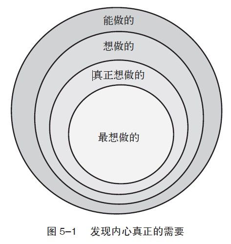

第5章 设定幸福目标

在一个惬意的环境中被动地生活所感受到的快乐，远远比不上那种有激情地投入到有价值的活动中，以及为目标而奋斗所能体验到的满足感。

——戴维·迈尔斯、艾德·迪纳

在我16岁开始意识到追求幸福的重要性时，我所理解的真正幸福就是我必须先达到一个无欲无求的境界——不再有需求与渴望，不再有使命与目标。因为我曾经渴望的目标（比如赢得冠军）不但没有带给我幸福，反而让我苦恼，几乎精神崩溃。我用了几年的时间才发现，原来有目标并不是问题，关键是什么样的目标，以及那些目标在我生命中所扮演的角色。

时至今日我可以肯定地说，做一个幸福的人，必须要有一个明确的可以带来快乐和意义的目标，然后努力地去追求。但在开始探索如何去设定一个适当的目标前，让我们先看看目标与成功的关系。

目标与成功

从整体而言，有目标的人的成功概率要比没有目标的人大得多。具有挑战性的明确的目标（即设定了时限和具体的成果）通常会带来更好的表现。设定目标就是用语言给自己一种承诺，而承诺本身会给我们带来更好的未来。

心理学已经证明了目标和成功之间的关系，这一点也已经被我们自身的经验反复证明。在英语的语源学里，“concept”（概念）和“conceive”（构想）的近似关系并非偶然。通过概念，通过语言，我们才能有所构思，新的现实才能显露。在希伯来语的《圣经》里，上帝用语言创造了世界，他说让光明照耀这块大地吧，然后就有了阳光。《约翰书》中开始的部分是“原初，我们有的只是语言”。同样美国也是以宣言的方式建国，通过语言表达了国家的目标、任务和价值观。

目标向我们及他人传达了一种克服困难的信念。把你的生命想象为一个旅程，你背着背包前进，忽然出现了一堵墙阻挡了你的去路，你该怎么办？你是转身避开，还是把你的背包扔到墙的另一头，然后想办法穿过、绕过或是翻过它？

1879年，托马斯·爱迪生宣布，他将在年底公开展示新发明——电灯。事实上，他之前的实验都是失败的，但他的做法就好像把背包扔到了墙的另一头。虽然他还面临很多的问题，然而在那年的最后一天，他真的成功了。1962年，肯尼迪总统向全世界宣布，美国将在20世纪60年代末把人类送上月球。当时甚至连一些太空船所需的材料都没有发明，技术方面更是完全不到位，结果他把自己以及美国国家航空航天局都推到了挑战的面前。“没有退路”让人类又一次取得了成功。虽然口头上的承诺不一定保证目标实现，但它确实可以增加成功的概率。

威廉姆·H·默里是苏格兰一个登山家，在《苏格兰人的喜马拉雅探险》（The Scottish Himalayan Expedition）中，他提到了把背包扔过去的好处：

一个人在下决心之前容易犯犹豫不决的毛病，容易退缩，效率降低。但重要的是，当你真正决定兑现承诺的时候，命运也会开始帮助你。如果不清楚这一点，再好的想法与计划也将付诸东流。当开始为自己的承诺付诸行动时，人们会发现，他们的运气变得出奇的好。我相当欣赏歌德的一句话：“无论你能做什么，或是你想做什么，行动吧！勇气本身就包含了智慧、奇迹和力量。”

一个目标，一个明确的承诺，可以让我们集中注意力，帮助我们找到达到目标的路线。目标可以简单到买电脑，或复杂到攀登珠穆朗玛峰。心理学家告诉我们，信念是一种会自动实现的预言。而当我们下定决心，把背包扔过墙头时，我们事实上已经相信了自己，相信了自身的能力。我们可以去创造现实，而不只是对现实做出被动的回应。

反思： 回想一下，你是否曾经承诺过做某一件事？你当时承诺的后果是什么？你目前对自己的承诺是什么？

目标与幸福

实验研究和经验性的证据已经清楚地显示出目标和成功的关系，而目标和幸福的关系则不是那么明显。传统的智慧告诉我们，幸福就是达到目标。但是，几十年的研究结果却让这种信念受到了严重的挑战：一个人在实现目标之后会感到满足，无法实现时则容易失望，而这些感觉其实都很短暂。

心理学家菲利普·布里克曼（Philip Brickman）及其同事的研究表明，乐透大奖得主在短短一个月的时间里，就已经回到了他们之前的幸福感水平——如果他们在中奖前是不快乐的，那他们就会回到不快乐的状态。同样，因车祸致残的人，在短短一年内就可以回到车祸前的快乐心态。

心理学家丹尼尔·吉尔伯特（Daniel Gilbert）继续拓展了此项研究，他发现人类对于未来情绪的预知能力是非常有限的。我们通常会认为一栋新房子、一部好车、职位晋升或是加薪等就可以使我们幸福，事实上，这些事情只能短暂地影响我们的整体幸福感。负面经历的影响也是一样的，如感情破裂的痛苦、失业等，而我们也会很快回到之前的心态。

以上的研究除了挑战传统的认识外，也带来了两方面的消息：好消息是我们不再那么害怕失败，坏消息则是成功似乎也变得不再那么重要了。如果真是这样，那么我们就不需要再去努力实现目标或追求幸福了，我们的生活就会成为比尔·默里在《土拨鼠日》（Groundhog Day）那部电影中描述的，或者就像西绪福斯劳而无功、不停地爬山的遭遇——不停地回到原点。

难道我们只能选择要么继续相信自己的幻觉（达到目标时就能使自己幸福），要么面对残酷的现实（无论我们怎么做，都无法获得真正的幸福）？幸运的是，我们还有第三个选择。之前的问题在于，无论他们是“虚无主义”的名人，还是满怀抱负的无名小卒，他们的方向都错了——他们不是只看结果、不管过程，就是只顾目的地、不顾旅程。当理解了这一关系，我们的目标就可以带来更多的幸福感。

目标很有意义

罗伯特·M·波西格（Robert M. Pirsig）在《禅与摩托车维修艺术》（Zen and the Art of Motorcycle Maintenance）中，提到他和一群老僧人攀登喜马拉雅山的故事。虽然波西格是成员中最年轻的，但和那些老僧人相比，他反而是爬得最辛苦的。

因为波西格只把注意力放在尽快登上山顶上，总是被前面的山路所影响，无法享受攀登的乐趣，最终导致失去了攀登的愿望和毅力。老僧人们当然也想登上山顶，但爬到山顶并不是第一要务，他们在确定正确的方向之后，就开始轻松愉快地享受着自己的路途，而不会被前面的山路所困扰。

目标的作用是为了帮助我们解放自我，这样我们才能享受眼前的一切。如果我们盲目地踏上任何旅途，那过程本身肯定不会有什么乐趣。如果我们不知道方向，甚至连自己要去哪里也不知道的话，那人生中每一个岔路就会变得非常矛盾——似乎向左向右都没错，我们不知道方向，也不知道每条路的终点。那样我们将无法享受旅途本身和风景等美好的事物，只会被犹豫和迷惑所吞噬——我这么走可以吗？我在这里转弯会走到哪里去？所以，只有当我们确认目标之后，我们才能把注意力放在旅途本身上。

我的上述理论的重点是要有目标，能否实现它则在其次。在“积极情绪的作用”一文中，心理学家戴维·沃森（David Watson）强调了旅途的重要性，“当代研究指出，为实现目标的奋斗过程，比达成目标更能带来幸福和积极的情绪影响”。目标是为了让我们能享受眼前，目标是意义，不是结局。

目标是意义，不是结局。如果想保持幸福感，就必须改变我们通常对目标的期望：与其把它当成一种结局（相信它可以使我们开心），不如把它看作是意义（相信它可以加强我们旅途中的快乐感受）。当目标被认可为意义时，它才会帮助我们规划旅途中的每一步；而目标被认为是结局时，它所带给我们的只会是无尽的困难和挑战。正确的目标认知，带给我们的是一种安宁。

目标是获得幸福的必需品，但它并不是全部。我们一定要明白，除了目标本身必须是有意义的之外，它在旅途中带给我们的快乐也是不可缺少的。

反思： 什么样的目标曾经在你的生命中带给你幸福？你认为什么样的目标可以在未来带给你幸福？

是不是所有的正确目标都可以带来同样的幸福呢？金钱是否有意义，而声望是否可以带来快乐呢？其实，对物质的追求和需要被关注的心态都是人类的本能反应，对一些人来说，这甚至是最重要的。既然这样，在追求幸福的过程中只注重财富和名声是不是就够了呢？

在对目标和幸福的研究中，肯农·谢尔登（Kennon Sheldon）和同事们写道：“对于追求幸福的人来说，我们的建议是，去追求包括成长、人际关系和对社会有贡献的目标，而不是金钱、美貌和声望。对后者的追求，通常是出于必须和压力的心态。”虽然大部分的人都在追求金钱、美貌和声望，可能有的时候还是被迫的，但是谢尔登指出，如果我们把目标重点放在自我和谐上，我们将会更快乐。这方面的研究能够帮助我们通过更好地设定目标来实现人生的快乐和意义，让我们的潜能得以最大化地发挥出来。

自我和谐的目标

自我和谐的目标，是发自内心最坚定的意识，或是最感兴趣的事情。这些目标按照谢尔登与艾略特所言，是从“整合自我”生发的“自我直接的选择”。这些目标必须是主动选择的，而不是被加附在我们身上的；必须是产生于散发自我光辉的愿望，而不是为了炫耀。这些目标是有因果关系的：追求这些目标，并不是因为他人觉得你应该这么做，也不是出于责任感，而是因为它对我们具有更深层的意义并且能够带给我们快乐。

研究也指出，那些外在目标的意义，比如我们在社会上的声望或是银行存款，它与我们内在目标的意义，比如个人成长或是与他人的关系，有着显著的不同。财富上的目标通常不是出于自我和谐，而是出于外在因素。大部分追求财富的人，为的是满足自身对金钱和社会地位的虚荣心。

在一项名叫“美国梦的黑暗面”研究里，蒂姆·卡瑟和理查德·瑞恩指出，如果在生命中只以追求财富为目的的话，那么带来的只有负面的后果。而且这些只追求财富的人通常也没办法充分地发挥他们真正的潜能，他们比其他人更有压力，更容易沮丧和焦虑。在身心合一方面，他们显得不健康，缺乏生命力。其他研究人员也得出了一样的结论：“在新加坡商业学院的学生中，那些内心看重物质价值的人，其自我实现度、生命力和幸福感普遍较低，更多的是焦虑，并且健康不良状况频发。”

心理学家并不是说我们完全不应该追求物质和声望，这样是违背现实的。他们也不是说物质不重要，食物、住所、教育和其他基本需要当然重要。但是，在基本需要之外，如果是以追求幸福为前提的话，财富和声望就不应该是我们所追求的核心。

虽然财富常被认为是外来目标，但在一些情况下，它也可以是自发性的目标，前提是它必须对我们的幸福有贡献。有些人赚大钱并不是要真的用到每一分钱，有时是因为它是努力的回报，也可能是因为它证明了自己的实力。在这些情况下，财富代表了个人成长的结果，而不只是累积的数字。

在另一种情况下，财富也可以是发自内心的目标，即它成为达成意义的手段。比如说有足够的金钱时，我们可以做很多对自己有意义但没时间去做的事，或者可以用它去支持我们认为有意义的事情。

虽然确定自我和谐的目标可以带来很多好处，但这并不容易。谢尔登和琳达·豪斯–马克曾提到，选择自我和谐的目标是“很难的技巧，需要正确的自我认知能力，还要有强大的自制力，因为社会影响和压力经常让我们做出错误的选择”。我们首先必须知道我们的生命需要什么，然后诚实地面对自己的愿望并且对它负责。

反思： 你的自我和谐目标是什么？追求这些目标时，你有没有碰到任何外来或是内在的障碍？

“想要做”与“不得不做”

自我和谐目标的前提就是，目标是自己在自由的情况下所选择的。这也解释了为什么民主制度下的人们活得要比专制制度下的人们幸福。但即使在最民主的制度下，人们有时候仍然感到自己被奴役了——这不是来自任何政府的影响，而是被外来的因素，比如说声望、欲望、责任或是恐惧所胁迫。他们感到生活里充满了各种不得不做的事，而这些都不是自己想做的事。那些不得不做的事情，通常不是缺乏意义，就是没有快乐，甚至两者皆无。而只有内心想做的事情是源于自我和谐的目标，才可以带来意义和幸福。

一个增强幸福感的方法，就是增加想要做的事并减少不得不做的事。无论是从人生或是日常生活的角度都应该如此。比如一个人学医是因为他觉得医学有意义（内在因素）还是因为医生有很好的社会地位（外在因素）？追求股票投资的成功，是因为它能带给我成就感（内在因素）还是因为它可以赚大钱（外在因素）？

以上的例子并不少见，我们所做的很多事，其动机都包含着内在和外在两种因素。一个因为家庭的压力而学法律的人，通常无法在其中找到长久的快乐；相反，如果是基于对法律的热爱而成为律师的话，那么维护正义的同时他也会觉得非常幸福。内在还是外在的动机，通常会决定行为本身的性质：如果是内在的（换句话说，就是自我和谐的），那便是想做的；如果动机来自于外在因素，就变成了不得不做的事了。

同样的分析也可以应用在日常生活中。想想你每天所做的事中，有哪些是自己想做的，哪些是不得不做的？而且有些不得不做的事情其实是无法避免的。对我个人来说，我想要教书，但从事了教学之后，我就不得不花很多时间批阅考卷。我们的挑战，不是要完全删除不得不做的事情，而是尽可能地减少它们，并以想要做的事情取而代之。不得不做的事情和想要做的事情的比例可以决定你的幸福感，它们甚至可以决定你早上起床和夜间入睡前的心态：在清晨，是满怀希望地起床，还是沮丧地想今天还有什么不得不做的事情？在入睡前，是感到充实和有成就感，还是长舒一口气说“哦，今天终于结束了”？

反思： 想象你平常的一天，是不得不做的事情多还是自己想要做的事情多？整体来说，你会不会对新的一天或者将要到来的一周满怀期望呢？

问问自己想做什么，什么能带给自己快乐和意义。这还不够，我们需要更深入地去认识自己。当年毕业时，哲学系教授奥哈德·卡米给了我一些建议：“生命很短暂，在选择道路前，先确定自己能做的事。在这些首先做的事中，做那些你想做的；然后再细化，找出你真正想做的；最后，把那些你最想做的事付诸行动。”奥哈德的话让我想到了四个圆，在最里面的那个圆代表我最幸福的选择（见图5–1）。

最外层的圆圈所包含的是我能做的，最里面的圆圈所包含的是我最深切的渴求和欲望。追求最想做的，它使我感到真实——真正成为我们自传的“作者”。我们可能未必总能实现我们最深切的期望，因为通常都会有不可控的因素存在，但诚实的态度和来自内心的答案，确实可以把我们带上正确的道路。须知一点，话语是可以创造世界的。

反思：什么是你最想做的事情，即内心最深切的渴望？

我的妻子泰米经常会和我一起设定目标，其中有她自己的目标，也有我们共同的目标。几年前，当我说要为一个目标设定期限时，她说，由于自我和谐的目标可以激发我们的无限潜能，并提供巨大的精神动力，我们应该把它们设定为终生的目标。同样，在追求有意义又快乐的目标时，我们并不是在消磨时间，而是在让时间发光。

正如亚伯拉罕·马斯洛所说，“当注意力集中在某一个任务上时，无论对个体还是环境都会产生积极的影响”。这个说法应用到自我和谐的目标上，会更加贴切，因为它结合了我们自身最大的兴趣和最深的需要。在最后一次受访中，20世纪神话学家约瑟夫·坎贝尔（Joseph Campbell）被问及他是否被“看不见的双手帮助”过时，他回答说：

那真是神奇的时刻。我甚至开始迷信——世上确实有看不见的力量在帮我——只要你跟随自己的天赋和内心，你就会发现生命的轨迹原已存在，正期待你的光临，你所经历的正是你应拥有的生活。当你能够感觉到自己正行走在命运的轨道上，你会发现，你周围的人开始不断地给你带来新的机会。不要怕，只要听从你内心的召唤，当你迷惘的时候，生活就会向你敞开大门。

就像自我和谐目标的研究所指出的，坎贝尔的感觉并不是迷信。当我们感受并追随生命的喜悦时，我们不仅可以享受人生，也会更加成功。反之，如果没有一个清楚的发自内心的方向，我们很容易就会陷入漫无目的的游荡，从真我的道路上被拉开。当我们知道自己的方向时（意识到那是自己非常想达成的目标时），我们就不容易迷路，也会更加忠于自己的内心。我们可以轻松地对外界那些强加到我们身上的东西说“不”，而对自己内心的声音说“是”。

时间是一个“零和游戏”，也是非常有限的资源。生命如此短暂，连做我们想做的事情都来不及，怎么能只用来做不得不做的事情呢？

练习

设定自我和谐的目标

追求自我和谐目标的人，通常不但更成功，而且比别人更幸福。自问一下，哪些是你在生活中真正想做的事，比如人际关系或职业规划，等等。在每个条目的下方注明以下的内容：

· 长期目标。这是指地基型的目标，从1年到30年的都可以。这应该是一些有挑战性的、能够让你发挥潜能的目标。还记得吗？目标是为了让我们享受旅途中的快乐，激发我们自身的潜力，实现与否倒在其次。我个人的一个长期目标是研究出一套增强幸福感的课程，包括出版书籍、演讲录像以及创办培训工作室，时限是在2013年6月1日之前（在我对目标的描述中，我会清楚地写明将要出版的书籍、演讲和各种工作室的具体细节）。

· 短期目标。这部分是针对分类消化长期目标而制定的。为实现自己的长期计划，你在未来的这段时期要怎么做？

· 行动计划。在未来的日子里，你需要做些什么来帮助目标的达成呢？给自己拟定一套行程表，无论是每日还是每周的（即你将要养成的习惯）或是一次性的。我目前正在做的就是我计划的一部分：每天用3个小时写书。

不为自己设定明确的目标，我们就会很容易被外界所影响，转而追求那些很难达到自我和谐状态的目标。我们总是面临两个选择，被动地受外来因素所影响，或是主动地去创造属于我们自己的生活。

幸福董事会

成立你自己的“幸福董事会”，成员是那些关心你和你的幸福并对你的幸福有着重要影响的人。让他们监督你的计划，并给予及时的建议。同时你要和他们经常会面，讨论哪里进行得好，哪里还需要更多的努力，以及哪些项目可能需要改进，等等。

信守自己的承诺，并不是一件容易的事。这种习惯和惯性的养成需要时间，这也是很多人会失败的原因，而得到他人的协助则对改变很有帮助（无论是开始一个计划、组织、克服困难，或是和家人多聚聚）。

除了成立自己的幸福董事会之外，你也可以成为他人幸福董事会的成员（即鼓励互动模式）。这样，你不但可以帮助自己，也可以帮助他人：在协助他人追求终极财富的同时，不知不觉中，也可以强化你自己对幸福的追求。当我们把自己放在一个特定的位置上时，我们关于某个想法的立场会更坚定。比如，当我们告诉他人有关幸福的重要性，以及提醒他们去追求有意义和快乐的活动时，我们自己就更有动力去做这样的事情。

第二篇 幸福无处不在
