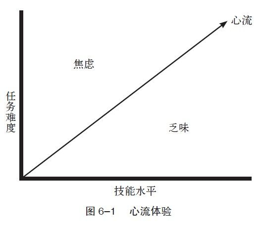

第6章 幸福学习法

教育是获得幸福的最好机会。

——马克·凡·都仑

我的弟弟约翰目前在哈佛大学就读心理学专业。在开始专业学习之前，他喜欢一切跟心理学有关的东西，比如读书、思考、写文章。而现在呢，他很厌恶心理学。

这并不是个别现象，多数学生都讨厌学习，那么又是什么原因让他们不得不努力用功呢？在与弟弟讨论这个问题之后，我发现了两种学习动机模式——“溺水模式”与“性爱模式”。

“溺水模式”有两个特点：（1）有从痛苦中解脱的强烈愿望；（2）一旦解脱，我们常会把那种舒适误认为是幸福。如果把一个人的头按进水里，这个人会痛苦，会挣扎着要出来。如果他在最后一刻离开水，他第一件事就是拼命地呼吸，接着便是那醉人的解脱感。

当然学生们的情况没有那么恐怖，但这种动机的性质（避免失败）却是相同的。在每个学期中，他们沉溺在自己不喜欢的作业里，因为考试失败会让他们感到恐惧；可一旦从书本、功课和考试中解脱，他们即刻就可以拥有那种轻松感，而这种感觉很容易被误认为就是幸福。

从孩提时代就被刻在我们脑海里的这种先苦后甜的模式，是我们唯一熟悉的生活方式，然后，“忙碌奔波型”就成为一种自然而然的有吸引力的选择了。

但“性爱模式”却提供了一种不同的学习方式，一种可以同时得到当下与未来幸福的模式。那些美好的学习时光，无论是阅读、研究、思考还是写作，都可以将其视为性爱的前奏。学生们的经验表明，当知识和直觉的界限消失时，即当我们找到答案时，就像是性高潮的感觉。在“溺水模式”里同样会有这种达成目标后的高潮，但在“性爱模式”中，我们却是从一开始乃至每一件事里都能得到快乐。

让学习本身成为一件快乐的事情，是每个学生的责任，尤其是在大学和研究生期间，因为那是最独立的学习时期。但是，通常多数学生进入这个独立时期的时候，已经养成了忙碌奔波的习惯。他们从父母那里学到的观念就是用名誉和成绩来衡量自己，他们最大的责任就是拿到好成绩，而不是去享受学习的快乐。父母与老师都希望孩子们得到幸福，但前提是他们自己必须首先相信：幸福才是至高的、最重要的财富。孩子们对暗示极端敏感，通常他们会把父母和老师的观点内化，即使这些观点并不明确。

在学校里，我们应该鼓励孩子们去追求快乐并且有意义的学习方式。如果一个学生对做社会工作者感兴趣，并开始考虑这个选择的得失，这时老师就应该鼓励他，而不是告诉他做生意可以赚得更多；如果他想从商，父母也应该支持他，而不是告诉他从政才是他们对他的期望。如果父母和老师都相信幸福是终极财富，那么这种鼓励就是最自然、最符合逻辑的选择。

反思： 回想一下，你记忆中最好的老师都做了什么来启发你对学习的兴趣？

当强调成果（实在的目标）多于养成对学习的兴趣（无法衡量）时，学校其实已经是在鼓励忙碌奔波的信念并且抑制孩子的情感成长了。“忙碌奔波型”所相信的就是成果比情感上的快乐更重要，因为他人只会对成果表示赞赏，而情感却会影响成果的获取，所以最好压制它或是根本不要理会它。

具有讽刺意味的是，事实上情感不仅是追求终极财富（幸福）的必需品，而且也是追求物质的必需品。丹尼尔·戈尔曼在《情商》一书里说道，“心理学家们一致同意，人类的智商（IQ）对于成功的帮助只有20%，其余80%则来自于其他的方面，其中就包括我所说的情商（EQ）”。“忙碌奔波型”的想法本身就和情商相冲突，更不要说既快乐又成功地生活了。

那么，老师和家长们应该做些什么来帮助学生在学校过得更开心，同时又不影响学业呢？心理学家米哈里·契克森米哈伊在其“心流理论”（.ow）中，教导我们如何创建适当的家庭和学校环境，来帮助其成员平衡当下与长远利益，同时获得快乐和意义。

心流体验

心流，根据契克森米哈伊的说法，就是个体完全地沉浸于体验本身，而体验本身就是最好的奖赏和动机。在心流状态中，我们的感觉和体验合二为一，即“行为和觉察融为一体”。

我们都有过沉迷于阅读或写作的经历，有时连别人叫我们都听不见；或者当我们在专心烹饪、和朋友谈心、在公园打球时，经常几个小时就在不知不觉中过去了。这些就是心流体验。

在心流状态中，我们享受着巅峰体验，同时也做出了巅峰表现：我们既感受到了快乐，又展现出最好的状态。运动员把这种情形称为“在状态”。无论我们在心流的境界里做什么，踢球也好，雕刻也好，写诗也好，学习也好，我们对于正在进行的事情采取的是一种全神贯注的态度，没有任何人或事可以打扰我们或是使我们分心。在这种最佳状态下，我们能够更有效地学习、成长、进步并且向未来的目标迈进。

根据契克森米哈伊的解释，拥有清晰的目标是心流体验的前提。虽然目标有时会有所改变，但我们行进的方向是不能错的。当我们全心全力投入去实现目标，不为任何其他的诱惑所动摇时，我们才能获得心流体验。同时，当下以及未来的益处在这种状态下合二为一：遥远的目标不但不是阻力，反而可以帮助我们感受正在经历的意义。心流体验所带来的是更高层次的幸福，它把“一分耕耘，一分收获”变成了“现在的快乐即未来的成果”。

契克森米哈伊的心流理论还指出：“一分耕耘，一分收获”的说法代表我们必须承受极度的压力，无论是身体上还是心理上的，才能发挥100%的潜力，实现至高的目标；但在心流体验中，痛苦本身并不是巅峰表现的最高境界；相反，有一个区域是在过难和过易之间，在这个区间内，我们不但可以发挥出最大的潜力，还可以享受过程中的快乐。如果想要达到这个境界，任务的挑战要难易适度（见图6–1）。

图6–1显示出，如果任务难度大而技能不足时，我们会感到焦虑；相反，如果技能高超而任务太简单时，我们就会感到乏味。只有当难度和技能匹配时，心流体验才有可能出现。

反思：回想一下，你什么时候有过心流体验？

许多学生不是感到焦虑就是觉得乏味，因此他们无法享受学习的过程或是发挥出真正的潜力。当学生期望当下和未来都有收获时，老师应该针对个人潜力，尽可能给予适当的课程和作业。就像前文所提示的，有两种不同的情况会影响学生拥有心流体验：一是有压力的环境，因为这样会带来焦虑；二是没有挑战性的环境，因为这样会使人觉得无聊、厌倦。

在第一种情况下，老师所应用的是“溺水模式”教学。由于学生的压力太大了，超出了他的能力范围，导致学业带来的只有痛苦、焦虑以及不幸福。学生被迫只注重结果而不是过程，只注重终点而不是旅途。在这种情况下，他们很快便会变成“忙碌奔波型”的人，始终感受不到心流体验，无论是在学业、工作或是在日常生活中。

第二种情况则刚好相反。挑战不足和乏味替代了挑战过大和焦虑。过小的挑战所带来的负面影响比起过大的挑战所带来的负面影响一点也不少，它们所剥夺的也不光是获得心流体验的可能性。教育者，尤其是家长，往往将奋斗和痛苦错误地同化（为了保护孩子），他们所犯的通病有两种：一是满足孩子的所有要求；二是把他们和所有的挑战隔离。在给孩子创造舒适生活的过程中，如果剥夺了孩子奋斗的机会，就是剥夺了他们体验心流以及克服困难的经验。

在我成长的过程中，我最喜欢的卡通片是《百万小富翁》（Richie Rich：The Poor Little Rich Boy），主人公是一个有钱但可怜的富家小孩——什么都不缺，但依然感到烦恼。故事所反映的其实就是当今社会，越来越多的有钱人（包括出身富裕的孩子）却拥有越来越多的不幸。有些人把这种情况称为“富贵病”，我把这称为“生活失重”。

生活失重

塞缪尔·斯迈尔斯是近代自助运动的创始人，他在1858年的一篇文章中提到，“我们应该教给所有的孩子：生命中真正的幸福和成就感必须依靠自己的付出与努力，而不是借助旁人的帮助”。如果家长帮着孩子逃避问题和挑战，只会导致未来的不幸。“人类最大的贫乏，就是事事顺心如意，无须努力，最终导致希望破灭，再无奋斗之心”。当面临挑战时，孩子其实和大人一样，他们会在成功中找寻意义，并且享受努力实现目标的过程。

生活失重可以在某种程度上解释为什么在这个社会中抑郁症的患病率会不断地上升，为什么患抑郁症的人越来越年轻，因为他们的生活实在是太过轻松容易了。

挣扎、困难和挑战都是丰富的生活不可或缺的，幸福之路并无捷径。但我们对于他人的困难（尤其是对孩子）通常的反应就是去帮助他们。事实上，应该放手让他们自己去迎接挑战。这听起来似乎不合常理，但我们必须抑制那种自然反应，让孩子们自己学会应对各种困境，茁壮成长。

有钱人经常不开心的另外一个原因，就是来自“有钱就应该开心”的压力。“我有钱，我怎么可能会不开心呢”，他们会为不开心而感到内疚，会觉得如果不开心就对不起自己所拥有的财富。如果他们找不到不开心的合适理由，就会把错误怪到自己头上。他们因为追求幸福而感到压力，也会对自己无法克服负面情绪而感到内疚和无能。在这个现实的世界中，很多人并不了解情绪好坏与物质多寡之间并不存在紧密的联系。

幸福面前人人平等

我们都拥有承受极大痛苦、极大快乐和其他介于痛苦和快乐之间的情绪的能力。虽然物质状况不同，但每个人都有争取终极财富（幸福）的能力。除了那些极端贫穷和受到政治迫害的人之外，幸福和不幸福其实是很公平的。在《究竟谁幸福？》（Who is Happy?）一文中，著名心理学家戴维·迈尔斯和艾德·迪纳指出，“就获得幸福和生活满意度而言，年轻人和老人、男人和女人、黑人和白人，以及穷人和富人所具备的能力是差不多的”。幸福面前人人平等。

正如18世纪经济学家和哲学家亚当·斯密所说，“关于人类的幸福感，穷人相比富人，幸福感并没有任何优劣之分”。虽然亚当·斯密是站在一个特权阶层的角度说话（他与当时的主流社会格格不入），但至少他说对了一点，那就是穷人的痛苦和欢乐，无论是在质量或数量上，和富人并无差别。在基本的生存条件（食物、住所、适当的教育）达到后，从情感的角度来说，经济状况并不会造成显著的差异。

此外，富人的不幸也很真实、自然，比起穷人的不幸没有任何差别——人类社会在这点上其实是很公平的。所有的人都会体验到不安、恐惧、快乐和幸福。无论我们是否富有，剥夺体验这些情绪的权利，其实就是在剥夺获得幸福的权利。甚至连虚无主义者都无可避免地会碰到不开心的事，若不去面对，只会导致更多的不快乐。无论收入或社会地位怎样，我们都要“全然地接纳自己”。

反思： 你会以自然心态去接受负面情绪，还是会排斥它们？你是否做到了“全然地接纳自己”？

工作让你更幸福

契克森米哈伊的研究指出，人在12岁时已经可以清楚地将工作和玩耍分开，这是一种伴随我们一生的分辨能力。孩子得到的一个明确信息是，教育就是家庭作业以及努力用功。把完成作业当成工作，很容易会使孩子们厌烦，因为只要是人，都不会喜欢“工作”。这种厌恶在西方社会里根深蒂固，在很多著名的文学作品中都可以找到佐证。

亚当和夏娃当初享受的是典型的快乐生活——他们没有工作，也没有对未来的打算。当他们因吃下禁果被赶出了伊甸园后，他们及子孙后代都必须辛苦工作。工作从此成了惩罚的标志之一，而我们会把天堂（一个完美的地方）形容成一个没有困难、没有工作的地方。但其实在地球上，我们必须工作才会有快乐。

在“工作与休闲中的最佳体验”研究中，契克森米哈伊和朱迪丝·勒菲弗指出，人类喜欢休闲多于工作（这是一个没有争议的结论），但人们在工作中的心流体验比在休闲活动中要多。

这种矛盾（我们说喜欢休闲，却在工作中得到更多的心流体验）令人深思，它说明了我们对工作存在偏见。我们常常把努力与痛苦、休闲与快乐联系在一起，这其实已经干扰了我们对于自身体验的客观认知。当我们开始把工作中的积极体验负面化时，其实也是在限制自己获得幸福的潜力，因为幸福并不仅仅是经历正面情绪，还要重视这个过程中的体验。

工作场所应该是一个我们可以感受正面情绪的地方。在《教学的勇气》（The Courage to Teach）一书中，教育家帕克·帕尔默写道，“在一个把痛苦和工作绑在一起的文化里，揭示工作最大的特征其实在于深度的幸福感，这是非常具有革命性的”。我们把工作、努力与痛苦绑在一起的恶习，已经深深地影响了我们在学校和工作中获得幸福感。

为了能让自己在工作和学习中得到更多的快乐，我们首先得改变自己的观点，改变对工作的偏见。唐纳德·赫布（Donald Hebb）在1930年所作的研究对我们很有帮助。

600个6~15岁的学生得到了这样的信息：他们不需要再做家庭作业。如果他们在课堂上表现欠佳，他们就会被罚出去玩；如果他们好好表现，他们会有更多的功课要做。结果在短短的一两天之内，学生们都选择了在课堂上好好表现而非出去玩耍（并且他们学到了更多的知识）。如果我们可以仿照这个实验过程改变对工作的态度，把工作视为一种特权，而不是责任（对孩子们也一样），这样我们不但感到更幸福，也可以学到更多的东西，同时也会有更好的表现。

反思： 你可否把工作和学习的体验看作是一种特权？你是否享受身处其中的感觉？

当我们对幸福的看法很刻板（即当我们把努力和挣扎排除在幸福感的来源之外）时，其实忽略了一些获得幸福的最大可能性。在学校和工作中，我们忽略了获得幸福的机会；在学校和工作之外，我们又拼命地消灭所有的挑战和困难。结果导致我们产生了这样一种感觉：幸福真是遥不可及。

最佳的教育应该教会学生在物质领域和精神领域同时成长。只关注技术上的东西是不够的，学校还必须突破写、读、计算等能力，我觉得还要再加上快乐。老师必须为学生创造一个快乐的学习环境。我们通常都会在教室里浸泡许多年，而我们人生中很多的习惯也正是在这段时间里培养出来的。如果学生在学校里被允许去追求幸福，从事获取这种终极财富的活动，那么他们就更可能养成这种受益一生的好习惯。但如果他们在学校里只是按着“忙碌奔波型”的模式去学习，那他们未来的人生也很可能就是那样。

不幸的是，我们目前的教育没能帮助学生找寻有意义和挑战性的活动，没能让他们体会到学习的乐趣，许多教育家注重的只是如何帮助他们拿到更高的分数。契克森米哈伊写道：

学校和家长在帮助孩子们找寻快乐这点上都做得不好。大人们自己经常被不实的典型所迷惑，并成为传播这一典型的同谋。他们把重要的事看得又难又无聊，却认定无关紧要的事是刺激和容易的。学校通常不能让学生体会到数学和自然课也可以那么迷人，那么令人激动；学校所教授的历史和文学往往停留在表面，而未曾发掘它们的奇妙之处。

每个人天生都具备对学习的热情，孩子们会不停地发问，不断地去发现周遭的世界。教育者作为帮助孩子追寻自身价值和获得心流体验的人，应该培养孩子求知的热情。他们可以把学习转变成一种迷人而美好的旅程，贯穿于整个生命对幸福的追求之中。

练习

制订学习计划

最成功的人都是活到老学到老的人，他们不停地发问，不停地去探索这个奇妙的世界。无论你处于生命中的哪一段，无论你是15岁或是115岁，无论你是风光无限还是正在艰难地奋斗，你都可以为自己制订一套学习计划。

你的计划可以包括以下这两个方面：个人成长和专业成长。在每类学习中，用心地去找寻快乐（比如阅读及思考）和意义（书中的知识会促进你全面成长），要把你的计划规律化、习惯化。

举个例子，在个人成长中，你可以阅读纳撒尼尔·布兰登的《自尊的六大支柱》（The Six Pillars of Self-Esteem），完成里面的练习。此外，还可以报名参加积极心理学的课程，养成写心理日记的习惯。至于专业成长方面，你可以找一个该领域的资深导师，并关注该专业领域的动态。

困境的意义

虽然我不相信发生的都是好事情，但我知道有一些人在任何环境中都能找到最好的一面。没有人会喜欢困难，但在我们的成长过程中，困难扮演着一个非常重要的角色，没有任何挑战的生命是没有意义的。

写下一个你所经历过的艰难时期——一次失败或是某段挣扎的时期。详细描述之后，写下在那个过程中你所得到的好处。当然，也不必刻意地淡化或减轻痛苦。想想看，那件事让你变得更有韧性了吗？你学到重要的东西了吗？你会不会变得更加心怀感恩呢？你有没有学到其他的经验？

如果你是在小组中完成这个练习的，就去试着与他人互相帮助，从各自的经历中学习。在所有困难中都有所收获才是最重要的。像我的同事安·哈比森所说的，“永远不要浪费从困境中学习的机会”。
