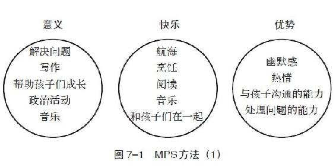
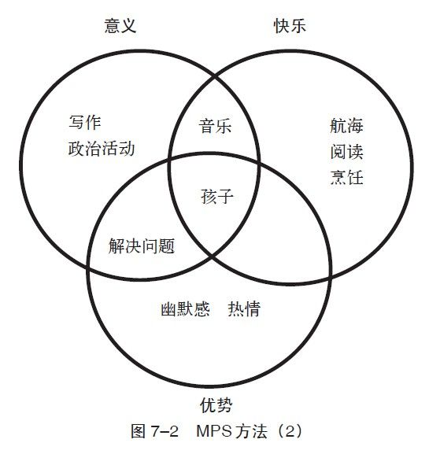

第7章 幸福工作法

品味辛勤劳作的快乐。

——亨利·沃兹沃思·朗弗罗

10年前我遇到过一个年轻人，他是一个律师，在纽约一家相当有名的公司上班，并且即将成为合伙人。从他的高级公寓里向外望，中央公园的美景一览无遗。他还刚用现款买了一辆全新的宝马汽车。

他非常努力地工作，每星期至少工作60个小时。每天早上他挣扎着起床，把自己拖到办公室；他感觉自己没有什么盼头——与客户和同事的会议、法律报告与合约事项占据了他的每一天，对他来说这些就是每天的任务。

当问起在一个理想世界里他还想做什么的时候，他说他想去一家画廊工作。我接着问他：“在现实世界里，无法找到画廊的工作吗？”他回答：“不是的。如果在画廊工作，收入会少很多，生活水平也会下降。”因为他对律师工作很反感，但又没有其他的选择。

他感到很不开心，因为被自己不喜欢的工作所牵绊。生活中，这样的人并不少见。在美国，只有50%的人对他们的工作满意。然而，我们发现，这些人之所以不开心，并不是因为真的别无选择，而是他们的决定（将物质与财富放在快乐和意义之上）让他们不开心。

热情是幸福的动力

在希伯来语中，工作（avoda）和奴隶（eved）两词的来源相同。绝大多数人都为了生活而工作。就算在生计不成问题时，本能仍然指挥着我们去工作：我们的使命是追求幸福，而为了幸福我们就必须工作。

然而，不论是生活需要还是社会法规，都不能阻挡我们体会真正的自由。只有在自己选择的快乐与意义并存的生活中，我们才能感受到自由。至于我们能否从工作中找到自由，取决于我们是愿意受制于物质财富、他人的期望，还是被自身的情感和热情所推动。

在做此类决定之前，我们应该先问自己一些问题。《圣经》里说，发问才会有答案。我们只有开始质疑自己，才会去探索和征服自己，才能看到一些以前看不到的事，发现一些以前被遮挡的道路。

在列出一些确切的问题后，我们可以挑战自己假设的情景及传统的思考方式：我工作快乐吗？如何才能更快乐？我会为了更快乐、更有意义的工作而辞职吗？如果我不能离开，有什么方法可以使我现在的工作更开心呢？

好的雇主可以营造出一个传播幸福的工作环境。心理学家理查德·哈克曼（Richard Hackman）的研究说明，一些外在条件可以帮助员工在工作中找到更多的意义：第一，这份工作必须能够激发员工的才华和潜力；第二，雇员应该获得更大的发挥空间，在公司的运作中扮演更重要的角色，而不只是旁观者；第三，雇员应该感受到他们的业绩是有意义的。能做到以上三点的雇主更有可能给雇员带来幸福。

正如我之前所讨论的，契克森米哈伊说明了一份难易适中的工作能提升员工的投入程度。雇主若能够考虑到这种工作投入感对雇员和组织所带来的好处，就可以更加合理地为员工安排最恰当的工作。

反思： 回想一下你最开心的工作体验，是具体的工作内容还是工作环境让你那么快乐？

我们不能只坐等好工作从天而降，我们必须主动去寻找或是在目前的工作中创造令人满意的环境。迁怒于他人（父母、老师、老板或是政府）或许会得到一些同情，但那不是幸福。找寻幸福的最大责任还是在我们自己身上。

在某些工作中，为了争取幸福，我们可以对工作进行适当调整。比如，即使工作没有特别的要求，我们还是可以为自己设定一些明确的目标，从平凡中寻求挑战，获取心流体验。我们可以主动承担更多的责任，更多地参与我们感兴趣的工作，或调换到其他部门加入新的项目。如果无论怎样努力，目前的工作都无法让我们感兴趣并投入其中，就应该考虑换工作了。当然，在某些情况下，离开我们当前的工作可能是个困难的选择，但我们总可以再找到新的工作，那样不但可以解决我们的温饱问题，还可以让我们更幸福。

下决心在工作中做出改变，或是寻找新工作可能会让人恐惧，但是如果一份工作在糊口之外无法给你带来任何幸福感，就确实需要有所改变。当收入不能满足自己的物质需要时，我们会不断地寻找更好的工作，以求从困境中解脱。试问一下，为什么当追求的目标是幸福时，我们却不能做出同样的努力呢？要在生活中做出改变，所需要的其实是勇气，而勇气本身不代表没有恐惧，而是感到恐惧的同时仍然付诸行动。

金钱和幸福都是生存的必需品，并非互相排斥。进一步说，通常在越感兴趣的事情上，我们越能发挥自己的天赋，做这些事情既有意义又可以让我们乐此不疲。我们通常会在感兴趣的事（所热衷的事情）上更努力。没有热情，动机便会削弱；有了热情，不但动机会坚定，连效率也会提高。

我们投入到工作中的努力，是无法仅用收入来衡量的。就像机器人的例子所说明的，如果没有任何热情，我们很快就会丧失兴趣。情感激发行动，热情则是我们的动力。

寻找使命感

心理学家亚伯拉罕·马斯洛曾写道，“人类最美丽的命运、最美妙的运气，就是从事自己喜爱的事情并获得报酬”。寻找如此“理想”的工作——这种能让我们更幸福的工作——并不容易。研究表明，人们对待工作的态度可以对此产生影响。

心理学家埃米·瑞斯尼斯基指出，人们对待工作有三种态度：任务、职业或使命感。如果一个人只是把工作作为一种任务及赚钱手段，而不是期待在其中有任何自我实现，这种情况下，每天去上班是因为他必须去，而不是他想去。除了薪水之外，他所期盼的就是节假日了。

把工作作为职业的人，除了注重财富的积累外，也会关注事业的发展，比如权力和声望等。他们关注的是下一个升职的机会，如从副教授到终身教授，从老师到校长，从副总统到总统，从助理编辑到总编辑。

对于把工作看成使命的人来说，工作本身就是目标。薪水和机会固然重要，但他们工作是因为他们想要做这份工作。他们的力量源于内在，同时也在工作中感到了充实与快乐。他们的目标正是自我和谐的目标。他们对工作充满热情，在工作中实现自我。工作对他们来说是一种恩典，而不是折磨。

反思： 你把你的工作当成是任务、职业，还是使命？据此反思你之前所从事的所有工作。

我们对工作的定位（无论是任务、职业还是使命）对工作本身及其他生活方面的幸福感均有影响。瑞斯尼斯基的建议是，“除了收入或地位之外，人们对于工作的定位，将在很大程度上决定他们对工作及生活的满意度”。

找寻使命感，需要努力和清醒的头脑。因为通常我们所得到的鼓励是去找一份适合自己当下能力的工作，而不是一份自己想做的工作；大部分的职业介绍所以及职业测验都注重我们目前的能力，而不是我们的热情。没错，像“我当前的能力优势是什么”这类问题，在寻找人生方向的过程中当然重要，但重点是这个问题的提出必须是在结合了意义和快乐的目标之后。如果我们的第一个问题是“我可以做什么”，我们就是在优先考虑实际问题（金钱或是他人期望的看法）；但如果第一个问题是“我想做什么”，即什么能带给我快乐和意义？那我们的选择才是以幸福作为衡量一切的标准。

MPS模式

MPS模式，指的是意义（Meaning）、快乐（Pleasure）和优势（Strengths）。寻找适合的工作（可以发挥我们的优势和热情）通常是很有挑战性的。我们用以下三个关键问题来问自己：什么能带给我意义？什么能带给我快乐？我的优势是什么？要注意顺序。然后看一下答案，找出这其中的交集，这样的工作就是最能使你感到幸福的工作。

做这个实验时，切记要用心，而不是胡思乱想瞎写一通。你会发现头脑中有很多现成的答案，但从中寻找到准确答案并不容易。比如在回答“什么能带给我们意义”这个问题时，我们需要尽量多地写下所有我们曾经做过的、让我们感到有明确目标的事情，认真地回忆和反思生命中的这些时刻，确定对我们而言真正有意义的事情。

如果多花些时间去思考这三个问题，答案可能会有很多，并且彼此交叉的地方一开始不一定那么明显。

找准人生定位

图7–1以一种简单方式来解释MPS模式的运用，而实际的情况可能会比示范图要复杂得多——如何通过思考MPS模式给我们带来幸福和成功？

比如：我觉得有意义的事情包括解决难题、写作、帮助孩子成长、参与政治活动以及音乐等。让我快乐的事情有航海、烹饪、阅读、音乐，还有和孩子们在一起。富有幽默感、热情、与孩子沟通的能力，以及处理问题的能力则是我天生的优势。

交集中的答案是什么呢？

从图7–2中可以马上发现，和孩子们在一起的活动可以带给我快乐和意义。再细化一下，现在需要考虑到我的个性以及生活习惯。比如说，我做事非常有计划，喜欢计划整个星期的工作，喜欢每日有规律地工作。我也喜欢旅游，所以工作之余最好有比较长的休息时间。

那么，哪些和孩子们有关的工作，既有规律性又有长一点的休息时间呢？什么样的工作能最好地发挥我的热情、幽默感和对阅读的热爱及解决问题的能力呢？权衡各方面因素之后，我发现做一个老师可能是最好的选择。使用这种方法不一定能帮助我们找到薪水最高的工作，却可以帮我们找到获得幸福的工作。

MPS方法也可以帮助我们在其他生活领域中做出重要的决策。例如在学校选修课程时，我们就可以去选择处在三者交集之中的课程，一个既可以为我们带来未来的意义，又能使我们快乐而且还可以发挥自身优势的选择。

MPS也可以成为管理者的好工具，帮助员工发现和从事他们自己感觉既有兴趣又有意义还能发挥个人优势的工作，这不但可以增强他们的投入程度，同时也可以提升他们的工作表现。MPS甚至可以帮助人力资源部门更好地选择新员工。在现实中，可能很难找到一个环境可以完全满足每个人的需要，以发挥每个人的优势。而管理者的重要工作之一，就是寻找员工和职位的契合点。

培养使命感

MPS方法给我们的另一个提示就是：人们有选择工作的权利，但如果实际情况是选择不多，或是根本没有选择呢？又或者由于一些外来因素而导致无法找到一份符合MPS标准的工作呢？其实，在一些情况下，职业和职位本身就可以发挥员工潜力，并且为他们带来意义和快乐。比如作为医生，其工作所带来的意义肯定要比卖二手车要重大得多。同样，瑞斯尼斯基的研究还说明，通常员工的职位越高，他们的使命感越强烈。

但无论是首席执行官还是职员，医生还是汽车销售，每个人都可以在自己的工作中找到使命感，从而获取更多的幸福感，让工作变成我们的使命而不是简单地打工。瑞斯尼斯基和简·达顿说过，“即使是在最受限制、最乏味的工作中，员工一样可以为工作赋予新的意义”。

在一项针对医院清洁工的研究中，一组人觉得他们的工作就是打工（无聊，也没有意义）；另一组人则觉得自己的工作很有意义，工作时很投入。第二组人在工作中充分发挥了创造性，他们与护士、病人以及家属交谈，把医院员工和病人的舒适看成是自己的责任。从整体上来说，这些清洁工看待工作的高度更高，并在其中找到了意义：他们不只是倒垃圾和洗衣服，正是他们的工作让医院正常运转，帮助病人康复。

若要获得更多的幸福感，就要明白我们对工作的认可有时候比工作本身更重要。正如医院优秀的清洁工认定了他们的工作可以为病患、为医院带来真正的改变，比起那些不认可自己工作的医生（那些看不见自己工作价值的人），他们其实更幸福。

研究者还发现，一些发型师、技工、护士以及饭馆的帮厨也因为在日常工作中找到了使命感，从而得到了更多的意义和快乐，他们与服务对象的关系也不再是简单的金钱关系。还有一些工程师，在技术层面之外，他们还看到了自己作为老师、团队的缔造者和维系者的意义，因此他们从看似机械的工作中获得了更多的使命感。

反思： 如何为目前的工作赋予更多的意义？你可以做出什么样的改变？

倾听幸福的声音

在《禅与摩托车维修的艺术》一书中，罗伯特·M·波西格写道，“生命的真相就在我们眼前，我们却常常让它走开，结果是真相离我们越来越远”。在日常工作中，我们常常对那些可以获得快乐和意义的机会视而不见。潜在的幸福如果没被注意到（如果我们只关注其他的东西），我们就将面临失去它的危险。想要把可能变成事实，我们首先必须认识到这些可能性是存在的。

幸福并不取决于我们得到了什么或身处何种境地，而取决于我们选择用什么样的视角去看待生活。有些人，无论工作或生活有多好，他们还是感觉不到幸福，但他们仍然不断地欺骗自己，认为外在因素可以最终改变内在体验。

爱默生说得很对：“对于不同的头脑，同一个世界可以是地狱也可以是天堂。”完全一样的事，带给每个人的感受也不同；我们选择去注意什么，往往决定了我们做事情时的享受程度，无论是人际关系、学习还是工作。举个例子，一个闷闷不乐的投资者，可以通过学习专注于他事业中那些与人生意义及快乐有关的事情来提升幸福感；如果他看重的只是数字，就很难在自己的事业中找到幸福。信念的改变可以带来巨大的差异，就像那些发型设计师、医院清洁工以及工程师所表现出来的一样，当我们关注幸福的时候就更容易发现幸福。

哈姆雷特说过，“事情没有好坏之分，只取决于你如何看待它”。他只说对了一部分。事实上，我们注意的部分（即我们的认知）非常重要，但这并不是说任何人在任何时间都能得到幸福。比如说，有些人无论怎样努力，都无法从他们的事业中找到让自己感到有意义和快乐的事。幸福是内外因素结合的产物——我们所追求的目标以及我们所专注的工作本身。

大部分人都可以找到相对满意的工作，但我们确实可以有更好的选择。为了帮助大家找到自己的使命感，让我们来听听我的学生艾伯尼·卡特的看法：“与其去关注我们需要什么才能生存，不如去关注我们没有什么就无法生存。”找寻使命感，是去回应自身内在的呼唤——那个能引导我们走向幸福的声音。

练习

三个问题：训练你对幸福的把握

花时间检视一下前文中提到的MPS方法，回答下面的问题，然后找出那些相互交叉的部分。

问题一：什么对我有意义？什么给了我使命感？

问题二：我觉得快乐的事情是什么？什么能带给我快乐？

问题三：我的优势是什么？我擅长做的又是什么？

通过这个步骤，可以帮助你在最宏观的层面（你生命里的使命是什么）以及最微观的层面（你希望每日的生活应该是怎样的）找到你的方向以及使命感。虽然它们联系紧密，但宏观层面的改变是需要很大的勇气的，比如离开目前的公司或者放弃现有的人生道路。微观层面的改变，比如每星期花两个小时做自己爱做的事，就容易得多。这些改变都可以帮助你获得更多的幸福感。

重塑你的工作

除了做出重大抉择来改变生活之外，另一个方法就是在现有的生活中增加那些自己觉得喜欢、有意义并且擅长的事情，或是从正在做的事情中挖掘幸福，通常我们不用挖掘得很深就可以发现它们了。

我们对于工作的偏见，或是对工作意义的狭隘认识，经常让我们错过生活的真相，事实上我们随时都有获得更多幸福的潜力。这个练习就是为了帮助我们重新发现那些隐秘的财宝。

描述一下你每天的日常活动，把它们填在本书第3章里“人生地图”练习的时间表上（或是做一个新的时间表，尤其是关于工作的）。在检视它们时，问自己两个问题：（1）你是否可以改变工作中的一些常规内容，增加让你感到有意义和快乐的工作内容，来替代不能激起你热情的那些任务？（2）无论你是否可以做出改变，自问一下，在目前的工作中有哪些部分违背了发掘的潜在意义和快乐？想象一下那些优秀的医院清洁工、发型设计师和工程师，他们是如何在工作中创造幸福的。他们并没有进行任何根本改变，比如更换工作或者工作环境，他们所做的只是赋予工作本身更多的意义，并且从中发现快乐，从而提升了工作的幸福感。

基于以上两个问题，我们可以把“工作描述”改写为“使命描述”。把自己目前的工作重新描述一下，要写得足够令人向往。当然这并不是说要言过其实或者夸夸其谈，而是客观地发现并记录下这份工作潜在的意义和快乐。我们看待工作的方式以及我们向他人介绍自己工作的方式，都可能极大地影响我们的体验。
