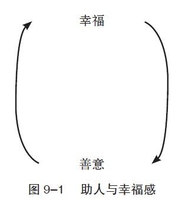

第9章 幸福的土壤：仁爱之心

不要问这个世界需要什么，而要问问什么会令你满足，并且为之做点什么吧！因为这个世界需要的，正是你为之付出的。

——惠特曼

教学是我的天分。我在集团里教过总裁，在大学里教过学生，还教过问题青年。讲课使我感到开心，它带给我当下的益处以及未来的益处——快乐和意义。我讲课是因为我想教（因为我热爱教课），并不是因为这些课需要我教（去满足他人的要求）。

换句话说，我不是一个利他主义者。我做任何事的最大理由（无论和朋友相聚或是当义工）都是因为它们可以让我开心。无论是用理论或是实际行动去解释终极财富，它都是我所有行为的目的。

很多人可能会觉得不安，觉得这是种自私的行为，即以自己的幸福、私利作为所有行动的出发点。无论明确或不明确，这种不安的来源都是一种信念，即一种道德上的责任感。

当代最具影响力的哲学家康德告诉我们，如果想使自己的行为有道德价值，必须出自于责任感。在只顾私利的情况下，我们的行为其实是没有道德价值的。按康德所说，如果一个人因为高兴而去帮助人（因为那样可以使他开心），那他所做的事是没有道德价值的。

有些哲学和宗教相信牺牲是道德价值的来源。就像康德一样，他们相信，持续地以私利为出发点，最终只会带来与他人利益的冲突；如果我们不与自私倾向斗争的话，我们将会伤害他人，无视他人的需要。

世俗的眼光所看不到的是，我们并不需要在利他或利己上做出选择，它们是可以共存的。事实上，就像哲学家爱默生所解释的那样：“人生最棒的补偿，就是世上没有任何人可以在不顾自己的情况下衷心地去帮助他人。”自助与助人是分不开的：帮助别人越多，自己就越开心；自己越开心，就越容易去帮助别人。

反思：回想一下你帮助人的时刻，再体会一下那种感觉。

助人与自助

为别人带来幸福，就是给自己带来意义与快乐，这就是为什么乐于助人是幸福人生的一大要素。然而，这并不能解释为我们应该为了别人而活。如果我们不为自己的幸福打算，慢慢地，我们会伤害自己，连带着也会伤害我们那颗乐于助人的心。一个不开心的人，不太可能会善待别人，由此所带来的则是更多的不快乐。

芭芭拉·弗雷德里克森的研究指出，积极的情绪会使我们的视野更开阔。这样，我们就不会只是以狭隘的眼光看待这个世界，而是会关注他人的需要和期望。事实上，艾利斯·艾森和詹妮弗·乔治在研究中也证明，我们越感到开心，帮助别人的可能性就越大。

我们最大的幸福来自于意义和快乐，如果其中还带着助人为乐的成分，那就是锦上添花了。在做决定时，我们必须先问自己，什么能让自己感到幸福；然后再看看我们的行为，是否会剥夺他人追求幸福的权利。如果是，那么我们也等于在渐渐地摧毁自己的幸福。如果我们伤害到他人，那么我们意识上的倾向及内在的正义感早晚会让我们在终极财富上付出代价。

一些人执着于道德责任感，总是在牺牲中找寻生命的道德意义；然而，牺牲本身并不快乐（如果快乐，就不叫牺牲了），于是道德上的责任感就慢慢地使快乐与意义对立了。

幸福不是牺牲，也不是在现在和未来中二选一。它既不是纯粹的意义也不是单纯的快乐，既不是只关注自己也不是无保留地为他人奉献——它是所有能够给我们带来幸福的要素，是和谐共生的结果。

练习

仁爱的冥想

让自己进入一个平静的状态，利用第2章结尾的“幸福冥想”练习。

回想一下你曾经善待他人的经历，以及由此而产生的成就感。用心灵的眼睛，对视那个人感激的目光，认真地体会那种感受，并让它具体化。当你再次在心里看到对方并体会自己当时的感受时，试着消除心中自助和助人的界限。

现在想象一件未来的事，比如和朋友分享快乐、给爱人买花、给孩子读书，或捐助你所信任的团体。体会在每次经历中你所能感受到的深度幸福感。
